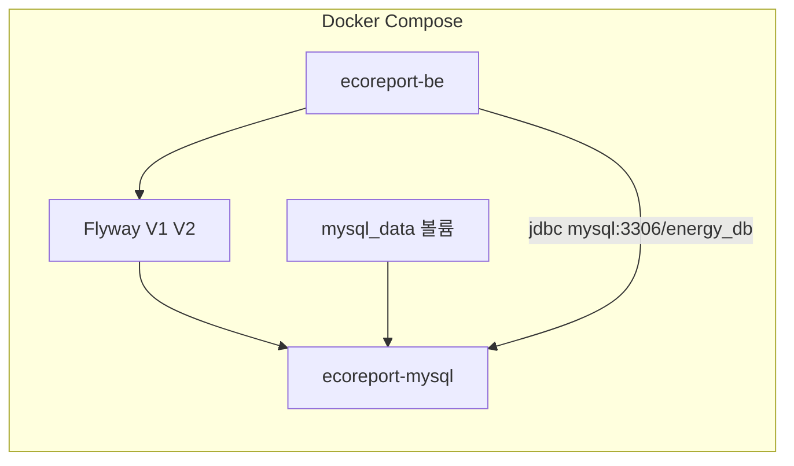

# DB 설정 가이드

EcoReport MySQL 스키마·Docker DB 단일화·운영 서버 설정을 정리한 문서.

---

## 1. 개요

| 항목 | 값 |
|------|-----|
| DBMS | MySQL 8.4 (Docker Compose) |
| DB 이름 | `energy_db` |
| **스키마 원본 (DDL)** | [`be/src/main/resources/db/migration/V*.sql`](../../../../be/src/main/resources/db/migration/) (Flyway) |
| 참조 스냅샷 | [`db/energy_schema.sql`](../../../../db/energy_schema.sql) (V2 적용 후 최종 상태) |
| JPA ddl-auto | `validate` (Hibernate가 스키마를 생성·변경하지 않음) |
| 데이터 영속 | Docker named volume `mysql_data` |

**원칙**

- 스키마 DDL의 **단일 원본**은 Flyway 마이그레이션 (`V1`, `V2`, …)이다.
- BE 기동 순서: **Flyway migrate → Hibernate validate → ApplicationRunner 시드**
- BE·FE는 **Docker MySQL만** 사용한다. 호스트(로컬) MySQL은 운영 서버에서 중지·비활성화한다.
- MySQL init SQL은 **DB 생성만** (Compose `MYSQL_DATABASE`). 테이블은 Flyway가 만든다.

---

## 2. 아키텍처



| 구분 | BE 연결 URL | 비고 |
|------|-------------|------|
| Docker BE (`SPRING_PROFILES_ACTIVE=docker`) | `jdbc:mysql://mysql:3306/energy_db?...` | Compose 내부 DNS `mysql` |
| 로컬 `./gradlew bootRun` | `jdbc:mysql://localhost:3306/energy_db?...` | Docker MySQL 3306 노출 또는 `be/db-init.sh` 후 호스트 MySQL |

> **`localhost:3306` 주의**: BE 컨테이너 안에서 `localhost`는 **컨테이너 자신**을 가리킨다. Docker BE는 반드시 `mysql:3306`을 사용해야 한다.

---

## 3. Flyway 마이그레이션

### 3.1 파일 목록

| 파일 | 내용 |
|------|------|
| `V1__baseline.sql` | affiliation, building, member, member_point, report (구 스키마) |
| `V2__location_node_tree.sql` | `location_node_db` 트리 + member/report FK 전환, `building_db` 제거 |

스키마 변경 시 **`V3__*.sql`** 등 새 버전 파일을 추가한다. (기존 V1/V2 수정 금지)

### 3.2 테이블 목록 (V2 이후)

| 테이블 | 설명 |
|--------|------|
| `affiliation_db` | 소속(캠퍼스·학교) |
| `location_node_db` | 장소 트리 (`parent_seq`, `node_kind` GROUP/LEAF, depth 1~3) |
| `member_db` | 회원 (`location_node_seq` FK — GROUP 노드) |
| `member_point_db` | 회원 포인트 (1:1) |
| `report_db` | 제보 (`location_seq` FK — LEAF 노드) |

### 3.3 JPA 엔티티 대응

| 엔티티 | 파일 |
|--------|------|
| `Affiliation` | `be/.../domain/model/Affiliation.java` |
| `LocationNode` | `be/.../domain/model/LocationNode.java` |
| `Member` | `be/.../domain/model/Member.java` |
| `MemberPoint` | `be/.../domain/model/MemberPoint.java` |
| `Report` + `WasteType` | `be/.../domain/model/Report.java` |

`ddl-auto: validate`이므로 **Flyway SQL + 엔티티**를 함께 수정한다.

### 3.4 기존 DB baseline

`application.yaml`:

```yaml
spring.flyway.baseline-on-migrate: true
spring.flyway.baseline-version: 2
```

이미 `location_node_db` 구조인 DB는 Flyway 첫 기동 시 **V2까지 적용된 것으로 baseline**하고 V1/V2를 재실행하지 않는다.

### 3.5 시드 데이터

BE 기동 시 `ApplicationRunner`가 빈 DB에 초기 데이터를 넣는다.

| 클래스 | 내용 |
|--------|------|
| `AffiliationDataInitializer` | 기본 소속 1건 |
| `LocationNodeDataInitializer` | 장소 트리 (건물 4건 + 하위 LEAF) |
| `AdminDataInitializer` / `UserDataInitializer` | 더미 계정 |

#### 더미 계정

| 구분 | 아이디 | 비밀번호 | 소속 장소 |
|------|--------|----------|-----------|
| 관리자 | `admin` | `admin1234!` | 공학관 A동 |
| 일반 | `user` | `user1234!` | 도서관 |

---

## 4. Docker Compose 설정

[`docker-compose.yml`](../../../../docker-compose.yml) mysql 서비스:

```yaml
mysql:
  image: mysql:8.4
  volumes:
    - mysql_data:/var/lib/mysql
  # init SQL 없음 — 스키마는 BE Flyway가 적용
```

- `mysql_data`: 컨테이너 재시작·재배포 후에도 데이터 유지
- **빈 DB**: BE 첫 기동 시 Flyway V1→V2 실행
- **기존 DB**: `baseline-version: 2`로 마이그레이션 스킵

---

## 5. 환경변수 (`.env`)

루트 [`.env.example`](../../../../.env.example) — `MYSQL_*`, `SPRING_DATASOURCE_*`, `DB_*` 참고.

---

## 6. 로컬 개발 DB 초기화

```bash
cp .env.example .env
bash be/db-init.sh     # DB·유저 생성만
bash be/run-dev.sh     # Flyway + BE 기동
```

---

## 7. 스키마 변경 워크플로

1. `be/src/main/resources/db/migration/V{n}__설명.sql` 추가
2. JPA 엔티티 수정
3. `bash be/run-dev.sh` 또는 `bash deploy.sh`로 validate 확인
4. (선택) `db/energy_schema.sql` 스냅샷 동기화

---

## 8. 트러블슈팅

| 증상 | 원인 | 조치 |
|------|------|------|
| SchemaManagementException | DB ≠ 엔티티 | Flyway 마이그레이션·엔티티 일치 확인 |
| Flyway validate failed | V1/V2 중복 실행 | `flyway_schema_history` 확인, baseline-version 조정 |
| 빈 DB에 테이블 없음 | BE 미기동 | `docker compose up -d be` — Flyway가 테이블 생성 |

---

## 9. 관련 문서

- [배포 가이드](./배포_가이드.md)
- Flyway 마이그레이션: [`be/src/main/resources/db/migration/`](../../../../be/src/main/resources/db/migration/)
- 참조 스냅샷: [`db/energy_schema.sql`](../../../../db/energy_schema.sql)
