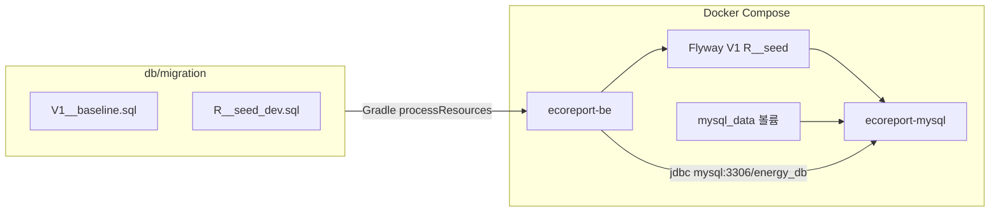

# DB 설정 가이드


EcoReport MySQL 스키마·Docker DB 단일화·운영 서버 설정을 정리한 문서.


---


## 1. 개요


| 항목 | 값 |

|------|-----|

| DBMS | MySQL 8.4 (Docker Compose) |

| DB 이름 | `energy_db` |

| **스키마·시드 원본 (SQL)** | [`db/migration/`](../../../../db/migration/) (Flyway) |

| JPA ddl-auto | `validate` (Hibernate가 스키마를 생성·변경하지 않음) |

| 데이터 영속 | Docker named volume `mysql_data` |


**원칙**


- 스키마·시드 SQL의 **단일 원본**은 `db/migration/` (`V*.sql`, `R__*.sql`)이다.

- BE 기동 순서: **Flyway migrate → Hibernate validate**

- BE·FE·MySQL은 **Docker Compose만** 사용한다 (`bash deploy.sh`).

- MySQL init SQL은 **DB 생성만** (Compose `MYSQL_DATABASE`). 테이블·시드는 Flyway가 적용한다.


---


## 2. 아키텍처





| 구분 | BE 연결 URL | 비고 |

|------|-------------|------|

| Docker BE (`SPRING_PROFILES_ACTIVE=docker`) | `jdbc:mysql://mysql:3306/energy_db?...` | Compose 내부 DNS `mysql` |


> **`localhost:3306` 주의**: BE 컨테이너 안에서 `localhost`는 **컨테이너 자신**을 가리킨다. Docker BE는 반드시 `mysql:3306`을 사용해야 한다.


---


## 3. Flyway 마이그레이션


### 3.1 파일 목록


| 파일 | 내용 |

|------|------|

| `V1__baseline.sql` | affiliation, location_node, member, member_point, report (현재 스키마) |

| `R__seed_dev.sql` | 개발 시드 (소속·장소 트리·admin/user 계정) |


스키마 변경 시 **`V2__*.sql`** 등 새 버전 파일을 추가한다. (기존 V1 수정 금지)


시드 변경은 `R__seed_dev.sql` 수정 (checksum 변경 시 Flyway가 재실행).


### 3.2 테이블 목록


| 테이블 | 설명 |

|--------|------|

| `affiliation_db` | 소속(캠퍼스·학교) |

| `location_node_db` | 장소 트리 (`parent_seq`, `node_kind` GROUP/LEAF, depth 1~3) |

| `member_db` | 회원 (`location_node_seq` FK — GROUP 노드) |

| `member_point_db` | 회원 포인트 (1:1) |

| `report_db` | 제보 (`location_seq` FK — LEAF 노드) |


### 3.3 JPA 엔티티 대응


| 엔티티 | 파일 |

|--------|------|

| `Affiliation` | `be/.../domain/model/Affiliation.java` |

| `LocationNode` | `be/.../domain/model/LocationNode.java` |

| `Member` | `be/.../domain/model/Member.java` |

| `MemberPoint` | `be/.../domain/model/MemberPoint.java` |

| `Report` + `WasteType` | `be/.../domain/model/Report.java` |


`ddl-auto: validate`이므로 **Flyway SQL + 엔티티**를 함께 수정한다.

장소 CRUD API: `GET/POST/PATCH/DELETE /api/admin/location-nodes` — [API_명세서.md](./API_명세서.md) · [장소_관리_모델.md](./장소_관리_모델.md)


### 3.4 시드 데이터


Flyway repeatable migration `R__seed_dev.sql`이 idempotent INSERT로 초기 데이터를 넣는다.


#### 더미 계정


| 구분 | 아이디 | 비밀번호 | 소속 장소 |

|------|--------|----------|-----------|

| 관리자 | `admin` | `admin1234!` | 공학관 A동 |

| 일반 | `user` | `user1234!` | 도서관 |


---


## 4. Docker Compose 설정


[`docker-compose.yml`](../../../../docker-compose.yml) mysql 서비스:


```yaml

mysql:

  image: mysql:8.4

  volumes:

    - mysql_data:/var/lib/mysql

  # init SQL 없음 — 스키마·시드는 BE Flyway가 적용

```


- `mysql_data`: 컨테이너 재시작·재배포 후에도 데이터 유지

- **빈 DB**: BE 첫 기동 시 Flyway V1 + R__seed 실행


---


## 5. 환경변수 (`.env`)


루트 [`.env.example`](../../../../.env.example) — `MYSQL_*`, `SPRING_DATASOURCE_*` 참고.


---


## 6. 배포·초기화


```bash
bash deploy.sh          # MySQL + Flyway + BE + FE 자동 (V*.sql 변경 시 DB 볼륨 자동 초기화)
```

`deploy.sh`가 자동 처리: `.env` 없으면 `.env.example` 복사 안내, BE/FE 헬스 대기, admin 로그인 스모크 테스트, URL 요약.

스키마를 **수동**으로 처음부터 다시 적용하려면:

```bash
docker compose down -v
bash deploy.sh
```


---


## 7. 스키마 변경 워크플로


1. `db/migration/V{n}__설명.sql` 추가

2. JPA 엔티티 수정

3. `bash deploy.sh`로 BE 재빌드·재기동 → Flyway 자동 적용·validate 확인


---


## 8. 트러블슈팅


| 증상 | 원인 | 조치 |

|------|------|------|

| SchemaManagementException | DB ≠ 엔티티 | Flyway 마이그레이션·엔티티 일치 확인 |

| Flyway validate failed | `flyway_schema_history` 불일치 | `docker compose down -v` 후 재배포 |

| 빈 DB에 테이블 없음 | BE 미기동 | `docker compose up -d be` — Flyway가 테이블 생성 |


---


## 9. 관련 문서


- [장소 관리 모델](./장소_관리_모델.md)
- [API 명세서](./API_명세서.md)

- Flyway 마이그레이션: [`db/migration/`](../../../../db/migration/)

