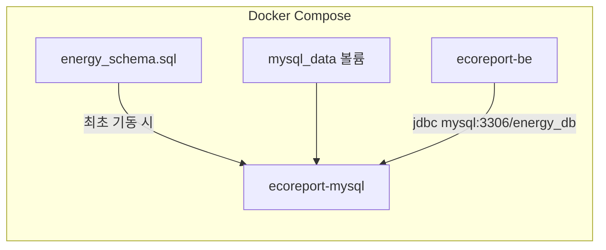

# DB 설정 가이드

EcoReport MySQL 스키마·Docker DB 단일화·운영 서버 설정을 정리한 문서.

---

## 1. 개요

| 항목 | 값 |
|------|-----|
| DBMS | MySQL 8.4 (Docker Compose) |
| DB 이름 | `energy_db` |
| 스키마 원본 | [`db/energy_schema.sql`](../../../../db/energy_schema.sql) |
| JPA ddl-auto | `validate` (Hibernate가 스키마를 생성·변경하지 않음) |
| 데이터 영속 | Docker named volume `mysql_data` |

**원칙**

- 스키마의 **단일 원본(Single Source of Truth)** 은 `db/energy_schema.sql`이다.
- BE·FE는 **Docker MySQL만** 사용한다. 호스트(로컬) MySQL은 운영 서버에서 중지·비활성화한다.
- init SQL은 **볼륨이 비어 있을 때 최초 1회**만 실행된다. 이후 데이터는 `mysql_data` 볼륨에 유지된다.

---

## 2. 아키텍처



| 구분 | BE 연결 URL | 비고 |
|------|-------------|------|
| Docker BE (`SPRING_PROFILES_ACTIVE=docker`) | `jdbc:mysql://mysql:3306/energy_db?...` | Compose 내부 DNS `mysql` |
| 로컬 `./gradlew bootRun` | `jdbc:mysql://localhost:3306/energy_db?...` | Docker MySQL 3306 노출 또는 `be/db-init.sh` 후 호스트 MySQL |

> **`localhost:3306` 주의**: BE 컨테이너 안에서 `localhost`는 **컨테이너 자신**을 가리킨다. Docker BE는 반드시 `mysql:3306`을 사용해야 한다.

---

## 3. 스키마 (`energy_schema.sql`)

### 3.1 테이블 목록

| 테이블 | 설명 |
|--------|------|
| `affiliation_db` | 소속(캠퍼스·학교) |
| `building_db` | 건물 (`address`, `affiliation_seq` FK) |
| `member_db` | 회원 (`user_type`, `affiliation_seq`, `building_seq` FK) |
| `member_point_db` | 회원 포인트 (1:1, `member_seq` UNIQUE) |
| `report_db` | 제보 (낭비 플래그 `bit`, `status` ENUM) |

### 3.2 JPA 엔티티 대응

| 엔티티 | 파일 |
|--------|------|
| `Affiliation` | `be/.../domain/model/Affiliation.java` |
| `Building` | `be/.../domain/model/Building.java` |
| `Member` | `be/.../domain/model/Member.java` |
| `MemberPoint` | `be/.../domain/model/MemberPoint.java` |
| `Report` + `WasteType` | `be/.../domain/model/Report.java` |

`ddl-auto: validate`이므로 엔티티 변경 시 **반드시** `energy_schema.sql`도 함께 수정한다.

### 3.3 시드 데이터

BE 기동 시 `ApplicationRunner`가 빈 DB에 초기 데이터를 넣는다.  
**이미 동일 `userName` 계정이 있으면 건너뛴다** (재기동 시 중복 생성 안 됨).

| 클래스 | 내용 |
|--------|------|
| `AffiliationDataInitializer` | 기본 소속 1건 (삼육대학교) |
| `BuildingDataInitializer` | 건물 4건 (공학관 A동, 도서관, 학생회관, 본관) |
| `AdminDataInitializer` | 관리자 계정 1건 |
| `UserDataInitializer` | 일반 사용자 계정 1건 |

#### 더미 계정 (로그인 테스트용)

| 구분 | 아이디 | 비밀번호 | 이메일 | 소속 건물 | `user_type` | 초기 포인트 |
|------|--------|----------|--------|-----------|-------------|-------------|
| 관리자 | `admin` | `admin1234!` | `admin@ecoreport.kr` | 공학관 A동 | `ADMIN` | 0P |
| 일반 사용자 | `user` | `user1234!` | `user@ecoreport.kr` | 도서관 | `USER` | 0P |

로그인 API: `POST /login` — body `{ "userName": "admin", "password": "admin1234!" }`

> **주의**: 개발·데모용 계정이다. 운영 배포 시 비밀번호 변경 또는 시드 비활성화를 권장한다.

#### 시드 재적용 (DB 초기화 후)

```bash
docker compose down -v
bash deploy.sh
# BE 기동 시 ApplicationRunner가 소속·건물·계정을 다시 주입
```

---

## 4. Docker Compose 설정

[`docker-compose.yml`](../../../../docker-compose.yml) mysql 서비스:

```yaml
mysql:
  image: mysql:8.4
  container_name: ecoreport-mysql
  environment:
    MYSQL_ROOT_PASSWORD: ${MYSQL_ROOT_PASSWORD}
    MYSQL_DATABASE: ${MYSQL_DATABASE}
    MYSQL_USER: ${MYSQL_USER}
    MYSQL_PASSWORD: ${MYSQL_PASSWORD}
  volumes:
    - mysql_data:/var/lib/mysql
    - ./db/energy_schema.sql:/docker-entrypoint-initdb.d/01-energy_schema.sql:ro
```

- `mysql_data`: 컨테이너 재시작·재배포 후에도 데이터 유지
- init SQL: **새 볼륨** 생성 시에만 실행 (`docker compose down -v` 후 첫 `up`)

---

## 5. 환경변수 (`.env`)

루트 [`.env.example`](../../../../.env.example) 기준:

```env
MYSQL_ROOT_PASSWORD=...
MYSQL_DATABASE=energy_db
MYSQL_USER=...
MYSQL_PASSWORD=...

SPRING_DATASOURCE_URL=jdbc:mysql://mysql:3306/energy_db?serverTimezone=Asia/Seoul&characterEncoding=UTF-8
SPRING_DATASOURCE_USERNAME=...
SPRING_DATASOURCE_PASSWORD=...

DB_URL=jdbc:mysql://localhost:3306/energy_db?serverTimezone=Asia/Seoul&characterEncoding=UTF-8
DB_USERNAME=...
DB_PASSWORD=...
```

| 변수 | Docker BE | 로컬 bootRun |
|------|-----------|--------------|
| `SPRING_DATASOURCE_*` | 사용 (`application-docker.yaml`) | — |
| `DB_*` | env_file로 로드되나 docker 프로필에서 datasource는 override | 사용 (`application.yaml`) |

---

## 6. 로컬 개발 DB 초기화

Docker 없이 호스트 MySQL을 쓸 때:

```bash
cp .env.example .env   # 값 입력
bash be/db-init.sh     # DB·유저 생성 + energy_schema.sql 적용
bash be/run-dev.sh     # BE 기동
```

[`be/db-init.sh`](../../../../be/db-init.sh)는 `CREATE DATABASE` 후 `db/energy_schema.sql`을 pipe한다.

---

## 7. 운영 서버 (`ubuntu03`) — Docker MySQL 단일화

**적용일**: 2026-05-24

### 7.1 변경 전후

| 항목 | 변경 전 | 변경 후 |
|------|---------|---------|
| Docker DB명 | `DBname` | `energy_db` |
| BE DB 연결 | `mysql:3306/DBname` + `DB_URL=localhost` 혼선 가능 | `mysql:3306/energy_db` only |
| 호스트 MySQL | `active` (3306 점유) | `inactive` / `disabled` |
| 스키마 생성 | Hibernate `ddl-auto: update` | init SQL + `validate` |

### 7.2 서버 접속

| 항목 | 값 |
|------|-----|
| SSH | `ssh -p 7540 se@202.31.202.189` |
| 프로젝트 경로 | `/home/se/duyuthon` |
| Docker MySQL CLI | `docker exec -it ecoreport-mysql mysql -u bz2149 -p` (PW: `.env`의 `MYSQL_PASSWORD`) |
| root | `docker exec -it ecoreport-mysql mysql -u root -p` (PW: `MYSQL_ROOT_PASSWORD`) |

MySQL은 Compose **내부 네트워크**에만 노출된다. 호스트에서 직접 `3306` 접속이 필요하면 호스트 MySQL 중지 후 `docker-compose.yml`에 `ports: ["3306:3306"]` 추가.

### 7.3 마이그레이션 절차 (데이터 초기화 OK)

```bash
cd /home/se/duyuthon
cp .env .env.bak.$(date +%Y%m%d%H%M%S)

# .env: MYSQL_DATABASE=energy_db, SPRING_DATASOURCE_URL=...mysql:3306/energy_db
# DB_URL도 localhost가 아닌 mysql:3306 (Docker BE 기준)

docker compose down -v    # mysql_data 삭제 → init SQL 재실행
bash deploy.sh

# 검증
docker exec ecoreport-mysql mysql -u bz2149 -p"$MYSQL_PASSWORD" energy_db -e "SHOW TABLES;"
curl -s http://localhost:8080/actuator/health

# 호스트 MySQL 중지
sudo systemctl stop mysql
sudo systemctl disable mysql
```

### 7.4 검증 체크리스트

```bash
# 호스트 MySQL 꺼짐
systemctl is-active mysql    # → inactive

# 3306 포트 (호스트 MySQL 중지 시 리스닝 없음)
ss -tlnp | grep 3306

# BE가 Docker DB 사용
docker exec ecoreport-be env | grep SPRING_DATASOURCE_URL
# → jdbc:mysql://mysql:3306/energy_db?...

# 테이블 5개 + building_db.address
docker exec ecoreport-mysql mysql -u bz2149 -p energy_db -e "DESCRIBE building_db;"
```

### 7.5 호스트 MySQL 완전 제거 (선택)

서비스만 중지한 상태. 패키지·데이터까지 삭제하려면:

```bash
sudo apt purge mysql-server mysql-client -y
sudo rm -rf /var/lib/mysql
```

---

## 8. 트러블슈팅

| 증상 | 원인 | 조치 |
|------|------|------|
| BE 기동 시 SchemaManagementException | DB 스키마 ≠ 엔티티 | `energy_schema.sql` 재적용 또는 `docker compose down -v` 후 재배포 |
| init SQL이 실행 안 됨 | `mysql_data` 볼륨이 이미 존재 | `docker compose down -v` 또는 수동 `mysql energy_db < db/energy_schema.sql` |
| BE가 호스트 DB에 연결 | `DB_URL=localhost:3306` + docker 프로필 미적용 | `SPRING_PROFILES_ACTIVE=docker` 확인, URL을 `mysql:3306/energy_db`로 수정 |
| 3306 포트 충돌 | 호스트 MySQL + Docker MySQL 포트 노출 동시 | 호스트 MySQL `stop` 후 Docker만 사용 |
| 스키마 변경 반영 | validate 모드 | `energy_schema.sql` 수정 → 볼륨 초기화 또는 ALTER 수동 실행 + 엔티티 동기화 |

---

## 9. 관련 문서

- [배포 가이드](./배포_가이드.md)
- [개발 환경 및 운영 서버](../../최종%20제안서/8_개발환경_및_운영서버.md)
- 스키마 파일: [`db/energy_schema.sql`](../../../../db/energy_schema.sql)
