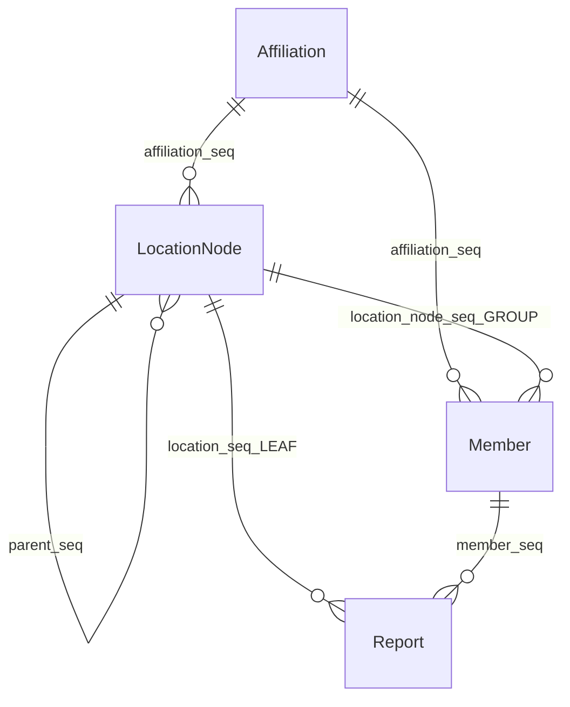

# 장소 관리 모델 (LocationNode)

> **작성 기준**: 2026-05-24  
> 캠퍼스 내 제보 대상 **장소**를 트리로 관리하는 현재 구현의 기준 문서입니다.  
> API 상세: [API_명세서.md](./API_명세서.md) · 향후 자원 확장: [자원_관리_설계.md](./자원_관리_설계.md)

---

## 용어 정책

| 맥락 | 용어 | 예 |
|------|------|-----|
| **학생 UX·서비스 설명** | 건물·강의실 | 제보 폼, 문제 정의 |
| **관리자 콘솔** | **장소 관리**, 1·2·3단계, **그룹/항목** | `/admin/buildings` |
| **API·DB** | `LocationNode`, `NodeKind`, `affiliationId` | Swagger, Flyway |

---

## 데이터 모델



| 엔티티 | 테이블 | 역할 |
|--------|--------|------|
| **Affiliation** | `affiliation_db` | 캠퍼스·단지 (예: 삼육대학교) |
| **LocationNode** | `location_node_db` | 장소 트리 노드 |
| **Member** | `member_db` | 소속 + 선택적 담당 구역(GROUP 노드) |
| **Report** | `report_db` | LEAF 노드에 연결된 제보 |

### LocationNode 필드 (`location_node_db`)

| 필드 | 타입 | 설명 |
|------|------|------|
| `seq` | BIGINT | PK |
| `parent_seq` | BIGINT | 상위 GROUP (루트는 null) |
| `affiliation_seq` | BIGINT | 소속 FK |
| `name` | VARCHAR | 표시 이름 |
| `node_kind` | ENUM | `GROUP` / `LEAF` |
| `depth` | INT | 1~3 |
| `sort_order` | INT | 정렬 순서 |
| `location_type` | VARCHAR | (미사용) |
| `ac_count` | INT | **LEAF 전용** — 에어컨 대수 (기본 0) |
| `fluorescent_count` | INT | **LEAF 전용** — 형광등 개수 (기본 0) |
| `led_count` | INT | **LEAF 전용** — LED 조명 개수 (기본 0) |

> **Phase 1**: 자원 수량은 `location_node_db`, **요일별 운영시간**은 `location_operating_schedule_db` (LEAF당 7행).  
> 절약량: `report.createdAt` + 스케줄 + AI ON/OFF → `SavingsCalculationService`. 상세: [자원_관리_설계.md](./자원_관리_설계.md#phase-1-공모전-mvp--leaf-컬럼)

### NodeKind

| 값 | 관리자 UI | 설명 |
|----|-----------|------|
| `GROUP` | **그룹** | 하위에 그룹·항목 추가 가능 |
| `LEAF` | **항목** | 제보 시 학생이 선택하는 최종 장소 |

### 깊이 규칙

- 최대 **3단계** (depth 1~3)
- depth 3에는 **항목(LEAF)** 만 등록 가능
- 그룹 노드에만 하위 추가 가능

### 구조 예시

**2단계** (시드 데이터 기본):

```
공학관 A동 (GROUP, 1단계)
├── 303호 (LEAF, 2단계)
└── 304호 (LEAF, 2단계)
```

**3단계**:

```
공학관 A동 (GROUP, 1단계)
└── 2층 (GROUP, 2단계)
    ├── 201호 (LEAF, 3단계)
    └── 202호 (LEAF, 3단계)
```

---

## API (구현됨)

### 공개·인증

| Method | Path | 설명 |
|--------|------|------|
| GET | `/api/affiliations` | 소속 목록 (회원가입·관리자) |
| GET | `/api/buildings` | 장소 트리 조회 (JWT 시 회원 scope) |
| PATCH | `/api/me/affiliation` | 소속·담당 건물 설정 |
| PATCH | `/api/me/building` | 담당 GROUP 노드 설정 |

`GET /api/buildings` 응답은 루트 GROUP을 `buildingId`로, 하위를 nested `children`으로 반환합니다 (`affiliationId`, `nodeKind` 포함).

### 관리자 (`UserType.ADMIN`)

| Method | Path | 설명 |
|--------|------|------|
| GET | `/api/admin/location-nodes/tree?affiliationId=` | 소속별 전체 트리 |
| POST | `/api/admin/location-nodes` | 노드 생성 |
| PATCH | `/api/admin/location-nodes/{id}` | 이름·sortOrder 수정 |
| DELETE | `/api/admin/location-nodes/{id}` | 삭제 (하위·제보 있으면 거부) |

**Create Body — GROUP (그룹)**

```json
{
  "parentId": null,
  "affiliationId": 1,
  "name": "공학관 A동",
  "nodeKind": "GROUP"
}
```

**Create Body — LEAF (항목, Phase 1 자원 수량 포함)**

```json
{
  "parentId": 1,
  "affiliationId": 1,
  "name": "303호",
  "nodeKind": "LEAF",
  "acCount": 1,
  "fluorescentCount": 8,
  "ledCount": 2,
  "operatingSchedules": [
    { "dayOfWeek": 1, "closed": false, "powerOnTime": "07:00", "powerOffTime": "22:00" },
    { "dayOfWeek": 7, "closed": true }
  ]
}
```

| 필드 | LEAF | 설명 |
|------|------|------|
| `acCount` | 선택 (기본 0) | 에어컨 대수 |
| `fluorescentCount` | 선택 (기본 0) | 형광등 개수 |
| `ledCount` | 선택 (기본 0) | LED 조명 개수 |
| `operatingSchedules` | 선택 (기본 7일) | 요일별 운영시간 (7행) |

**Update Body — LEAF 자원 수정**

```json
{
  "name": "303호 (대형)",
  "acCount": 2,
  "fluorescentCount": 10,
  "ledCount": 4
}
```

---

## Front-End (구현됨)

| 경로 | 설명 |
|------|------|
| `/admin/buildings` | **장소 관리** 화면 (라우트명은 legacy, UI 명칭은 장소 관리) |
| `fe/src/features/admin/buildings/` | 3단 컬럼 탐색기 + Sheet CRUD |
| `locationTreeUtils.ts` → `LOC` | 관리자 용어 상수 (1·2·3단계, 그룹/항목) |

### 관리자 UX 요약

- **1단계 | 2단계 | 3단계** 3열 컬럼 탐색기
- 추가·수정: 우측 Sheet (유형: 그룹/항목)
- **항목(LEAF) 등록·수정 시**: 에어컨/형광등/LED 수량 + **요일별 운영시간(7일)** 입력
- **소속**: 관리자 계정에 고정 (select 없음, JWT scope에서 `affiliationId` 조회)
- `locationNodesApi`: mock fallback 없음 (항상 BE 호출)

### 제보 관리 (`/admin/reports`)

- 장소 컬럼: **상위 그룹 경로(작게)** + **항목명(크게)**
- `locationPath` 필드 (예: `공학관 A동 > 2층 > 201호`) — BE 미연동 시 `buildingName`+`roomName` fallback
- 데이터: FE mock (`adminApi`)

---

## 미구현 (목표 설계)

| 항목 | 비고 |
|------|------|
| `ResourceType`, `LocationResource` (전체 자원 체계) | Phase 2 — [자원_관리_설계.md](./자원_관리_설계.md) |
| LEAF 자원·스케줄 → 절약량 계산 | ✅ `SavingsCalculationService`, 제보 `estimated_*` 저장 |
| 관리자 승인 → 포인트 확정 적립 | ⏳ Kafka `PointConsumer` |
| `GET /api/admin/reports`, `GET /api/admin/dashboard` | FE mock |
| `POST /admin/buildings` (구 명세) | LocationNode API로 대체됨 |
| `locationType` 컬럼 | 스키마 존재, create/seed 미설정 |

---

## 시드·DB

- Flyway: `db/migration/V*.sql` + repeatable `R__seed_dev.sql`
- 시드: 삼육대학교 1개 소속, 건물 4개(루트 GROUP), 각 건물 하위 LEAF 항목
- 더미 계정: `admin` / `admin1234!` (공학관 A동 scope, ADMIN)

상세: [DB_설정_가이드.md](./DB_설정_가이드.md)
