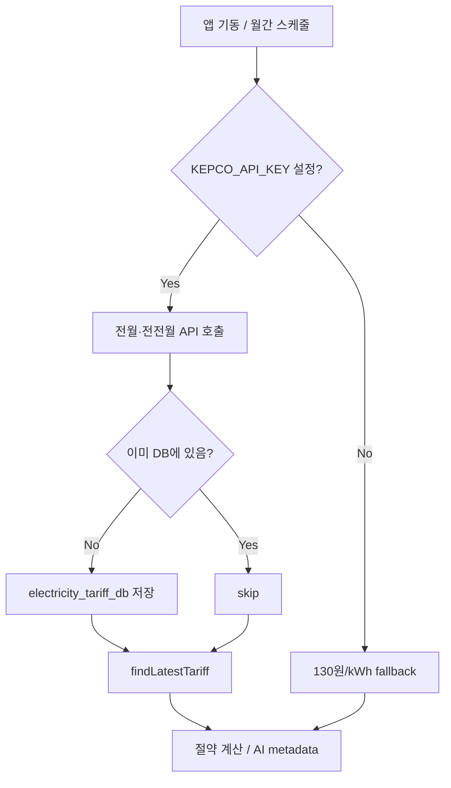

# 전기 단가 동기화 (한전 OPEN API)

> 절약 금액 환산에 쓰는 **전기 단가(원/kWh)** 를 한국전력공사 **전력데이터개방포털** OPEN API에서 **월별**로 수집·저장하고, BE 절약 계산·AI 제보 metadata에 반영한다.  
> 구현: BE `ElectricityTariffService`, Flyway `V9__electricity_tariff.sql`

---

## 1. 요약

| 항목 | 내용 |
|------|------|
| **데이터 출처** | [전력데이터개방포털](https://bigdata.kepco.co.kr) — 계약종별 전력사용량 API |
| **사용 필드** | `unitCost` (평균판매단가, 원/kWh) |
| **기본 계약종별** | **교육용** (`cntrCd=400`) — 캠퍼스·교육시설에 해당 |
| **수집 주기** | 앱 기동 시 + **매월 5일 03:00** (전월·전전월 보강) |
| **Fallback** | API 키 미설정·수집 실패 시 `EnergyConstants.ELECTRICITY_RATE_KRW` (**130**원/kWh) |

---

## 2. 외부 API

### 2.1 엔드포인트

| 항목 | 값 |
|------|-----|
| URL | `https://bigdata.kepco.co.kr/openapi/v1/powerUsage/contractType.do` |
| 메서드 | GET, POST |
| 인증 | `apiKey` (포털 발급 **40자리**) |
| 공식 가이드 | [계약종별 전력사용량 API](https://bigdata.kepco.co.kr/cmsmain.do?scode=S01&pcode=000493&pstate=cntr&redirect=Y) |
| data.go.kr | [한국전력공사_계약종별 전력사용량](https://www.data.go.kr/data/15101360/openapi.do) |

### 2.2 요청 파라미터

| 파라미터 | 필수 | 설명 |
|----------|------|------|
| `year` | ✅ | 조회 연도 (YYYY) |
| `month` | ✅ | 조회 월 (MM) |
| `cntrCd` | 선택 | 계약종별 코드 (미입력 시 전 종별). 기본 **400=교육용** |
| `metroCd` | 선택 | 시도 코드 (미입력 시 전국 `totData`) |
| `cityCd` | 선택 | 시군구 코드 |
| `apiKey` | ✅ | API 인증키 |
| `returnType` | 선택 | `json` (기본) |

**요청 예시**

```
https://bigdata.kepco.co.kr/openapi/v1/powerUsage/contractType.do
  ?year=2024&month=12&cntrCd=400&apiKey=xxx&returnType=json
```

### 2.3 응답 필드 (사용 항목)

| 필드 | 설명 |
|------|------|
| `data` / `totData` | 지역·종별별 목록 (`metroCd` 미선택 → `totData`) |
| `unitCost` | **평균판매단가** (원/kWh) — 절약 금액 계산에 사용 |
| `powerUsage` | 전력사용량 합계 (kWh) — DB 참고용 저장 |
| `bill` | 전기요금 합계 (원) — DB 참고용 저장 |
| `custCnt` | 고객호수 |
| `cntr` | 계약종별명 (예: 교육용) |

### 2.4 계약종별 코드 (참고)

공통코드 API: `https://bigdata.kepco.co.kr/openapi/v1/commonCode.do?codeTy=cntrCd&apiKey=xxx&returnType=json`

| 코드 | 명칭 (예) |
|------|-----------|
| 100 | 주택용 |
| 200 | 일반용 |
| 400 | 교육용 (기본값) |

> 실제 코드값은 포털 공통코드 API 기준으로 확인한다. 캠퍼스 MVP는 **교육용(400)** 을 사용한다.

---

## 3. BE 구현

### 3.1 패키지·클래스

```
org.example.be.service.tariff/
├── KepcoOpenApiClient          # contractType.do 호출
├── KepcoContractTypeResponse   # JSON 역직렬화
├── KepcoContractTypeItem
├── ElectricityTariffService    # 저장·조회·동기화
└── ElectricityTariffSyncScheduler  # @Scheduled + 기동 시 sync
```

| 클래스 | 역할 |
|--------|------|
| `ElectricityTariff` | JPA 엔티티 → `electricity_tariff_db` |
| `ElectricityTariffRepository` | 월별·종별 조회 |
| `SavingsCalculationService` | `getEffectiveUnitCostKrw()`로 절약 원화 계산 |
| `ReportService` | AI metadata에 `electricityRateKrw` 포함, form 필드 `metadata_str` |

### 3.2 DB 스키마

Flyway: [`db/migration/V9__electricity_tariff.sql`](../../../../db/migration/V9__electricity_tariff.sql)

| 컬럼 | 설명 |
|------|------|
| `year_month` | `YYYY-MM` (UK with `contract_type_code`) |
| `contract_type_code` | `cntrCd` (기본 400) |
| `contract_type_name` | API `cntr` (예: 교육용) |
| `unit_cost_krw` | `unitCost` (DECIMAL) |
| `power_usage_kwh`, `bill_krw`, `cust_count` | API 원본 참고 |
| `fetched_at` | 수집 시각 |

### 3.3 단가 적용 흐름



### 3.4 동기화 정책

| 시점 | 동작 |
|------|------|
| `ApplicationReadyEvent` | `syncRecentMonths()` — 전월·전전월 |
| Cron (기본 `0 0 3 5 * *`) | 매월 5일 03:00 동일 |
| 중복 | 동일 `year_month` + `contract_type_code` 이미 있으면 **재수집 안 함** |

한전 월별 통계 반영이 1~2개월 지연될 수 있어 **전월·전전월** 두 달을 시도한다.

---

## 4. 환경변수

프로젝트 루트 [`.env.example`](../../../../.env.example) 참고.

| 변수 | 필수 | 기본값 | 설명 |
|------|------|--------|------|
| `KEPCO_API_KEY` | 선택 | (빈 값) | 전력데이터개방포털 API 키. **미설정 시 동기화 비활성 + 130원 fallback** |
| `KEPCO_CONTRACT_TYPE_CODE` | 선택 | `400` | 계약종별 코드 |
| `KEPCO_CONTRACT_TYPE_NAME` | 선택 | `교육용` | API `cntr` 없을 때 표시명 |
| `KEPCO_SYNC_CRON` | 선택 | `0 0 3 5 * *` | Spring `@Scheduled` cron |

`application.yaml`:

```yaml
app:
  kepco:
    api-key: ${KEPCO_API_KEY:}
    contract-type-code: ${KEPCO_CONTRACT_TYPE_CODE:400}
    contract-type-name: ${KEPCO_CONTRACT_TYPE_NAME:교육용}
    sync-cron: ${KEPCO_SYNC_CRON:0 0 3 5 * *}
```

### 4.1 API 키 발급

1. [전력데이터개방포털](https://bigdata.kepco.co.kr) 회원가입
2. OPEN API 이용 신청 → **계약종별 전력사용량** API 선택
3. 발급된 **40자리 apiKey** 를 `.env`의 `KEPCO_API_KEY`에 설정
4. `bash deploy.sh` 로 BE 재기동 (Flyway V9 적용 포함)

---

## 5. AI·FE 연동

### 5.1 AI metadata

`AiAnalyzeMetadata`에 `electricityRateKrw`(Integer) 추가. BE가 DB 최신 단가(또는 fallback)를 AI `/analyze` 요청에 포함한다.

```json
{
  "reportedAt": "2026-05-25T22:00:00",
  "acCount": 1,
  "fluorescentCount": 10,
  "ledCount": 2,
  "operatingSchedules": [ ... ],
  "electricityRateKrw": 102
}
```

- BE → AI form 필드명: **`metadata_str`** (FastAPI 파라미터와 일치)
- AI (`ai/for_deploy/campus_api/main.py`): metadata의 `electricityRateKrw`가 있으면 프롬프트·`expected` 계산에 사용

> Cloud Run AI를 **재배포**해야 metadata 기반 단가가 제보 금액에 반영된다.

### 5.2 FE

현재 FE는 전기 단가를 직접 조회하지 않는다. 홈·마이페이지 탄소·나무 환산은 kWh 기준이며, 금액 표시는 BE/AI가 내려준 값을 사용한다.

---

## 6. 절약 금액 공식 (갱신)

기존 고정 단가:

```
절약_원 = kWh × 130
```

동기화 적용 후:

```
절약_원 = kWh × effective_unit_cost_krw
effective_unit_cost_krw = electricity_tariff_db 최신 unit_cost_krw
                        ?? EnergyConstants.ELECTRICITY_RATE_KRW (130)
```

포인트: `round(절약_원 × 0.18)` — 변경 없음.

상세 공식·근거: [절약량_환산_공식_및_근거.md §2.3](./절약량_환산_공식_및_근거.md)

---

## 7. 운영·트러블슈팅

| 증상 | 확인 |
|------|------|
| 항상 130원/kWh | `KEPCO_API_KEY` 비었는지, BE 로그에 *동기화 생략* 메시지 |
| 동기화 실패 | API 키 유효성, 포털 트래픽 한도, 해당 월 데이터 미공개(1~2개월 지연) |
| DB 확인 | `SELECT * FROM electricity_tariff_db ORDER BY year_month DESC;` |
| 스키마 미적용 | `V9__electricity_tariff.sql` — `bash deploy.sh` (Flyway) |

로그 예시 (성공):

```
전기 단가 동기화 완료 — 2025-04 102.10원/kWh (교육용 / cntrCd=400)
```

---

## 8. 테스트

| 테스트 클래스 | 내용 |
|---------------|------|
| `ElectricityTariffServiceTest` | fallback, DB 최신값, API 저장, 중복 skip |
| `SavingsCalculationServiceTest` | mock `ElectricityTariffService`로 절약 계산 |

```bash
cd be
bash gradlew test --tests "org.example.be.service.tariff.*"
```

---

## 9. 관련 문서

- [절약량_환산_공식_및_근거.md](./절약량_환산_공식_및_근거.md) — kWh·단가·CO₂ 공식
- [AI_모델_설계.md §3](./AI_모델_설계.md) — Gemini metadata·expected 계산
- [DB_설정_가이드.md](./DB_설정_가이드.md) — Flyway·테이블 목록
- [배포_가이드.md §4](./배포_가이드.md) — `.env` 변수
