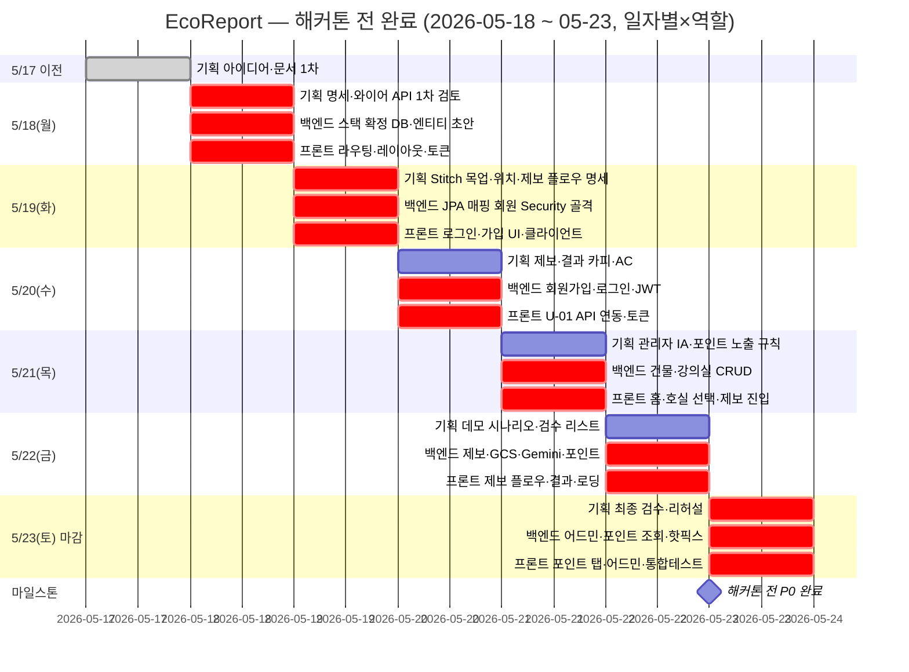

# 추진 일정 (Project Schedule)

---

## 해커톤 일정 기반 마일스톤

> 해커톤 정확한 일정이 확정되면 날짜 업데이트 필요.  
> 현재 기준: 2026-05-17 아이디어 확정, 해커톤 본 행사는 5월 말~6월 초 추정.  
> **P0 구현·통합 완료 목표: 2026-05-23(토)** — 당일은 시연·보완·발표 준비 위주로 두기 위함(상단 간트 참고).

---

## Phase 0 — 사전 준비 (해커톤 시작 전)

| 일정 | 작업 | 담당 |
|------|------|------|
| 5/17 (완료) | 아이디어 확정 (조명 최적화 크라우드소싱) | 전체 |
| 5/17~18 | 기획 문서 작성 (기능 정의, 와이어프레임) | 김해준 |
| 5/18~19 | 기술 스택 최종 확정, 개발 환경 세팅 | 차성호, 이은총 |
| 5/19 | DB 스키마 초안 확정 | 차성호, 이은총 |
| 5/19 | UI 목업 초안 (Google Stitch) | 김해준 |
| 5/19 | API 명세 최종 검토 | 전체 |

---

## 해커톤 전 완료 간트 (~5/23)

> **전제**: P0 구현·통합은 **해커톤 당일 신규 개발이 아니라, 해커톤 시작 전에 끝낸다.**  
> **마감**: **2026-05-23(토)** 까지 완료.  
> 차트는 **일자별(5/18~5/23)** × **기획 / 백엔드 / 프론트** 당일 목표. (`기능_정의서.md` P0 흐름)  
> **UI 목업**: **Google Stitch** 사용(Figma 미사용). 스크린 프롬프트·토큰은 `docs/디자인/stitch_프롬프트.md` 참고.  
> `done` 등 상태는 작성 시점 가정 — 실제 일정에 맞게 수정.

### 일자별 일정 (텍스트)

역할별 담당 참고: **기획** 김해준 · **백엔드** 차성호·이은총 · **프론트** 김해준 중심(필요 시 기획·백 지원).

| 날짜 | 기획 | 백엔드 | 프론트 |
|------|------|--------|--------|
| **5/17(일)** | 아이디어 확정, 기획 문서·기능 정의 1차 | — | — |
| **5/18(월)** | 명세·와이어 정리, API 명세 1차 검토 | 스택 확정, 로컬 DB·엔티티 초안 | 라우팅·레이아웃·디자인 토큰·공통 베이스 |
| **5/19(화)** | Stitch로 화면 목업 초안, 위치·제보 플로우 반영, API·화면 명세 확정 | JPA 매핑, 회원 도메인, Spring Security 골격 | 로그인·회원가입 화면, Axios·API 클라이언트 |
| **5/20(수)** | 제보·결과 카피, 에러·빈 상태 문구, AC(인수 조건) | 회원가입·로그인 API, JWT 발급·검증 | U-01 로그인·가입 실연동, 토큰 저장 |
| **5/21(목)** | 관리자 정보 구조·목록 컬럼, 포인트 노출 규칙 문구 | 건물·강의실 CRUD API | 홈 화면, 호실 선택, 제보 진입 UX |
| **5/22(금)** | 데모 시나리오(시연 순서·대사), 검수 체크리스트 | 제보 API, GCS 업로드, Gemini 연동, 포인트 적립·어뷰징 | 제보 전 플로우, 판별 결과·로딩·에러 UI |
| **5/23(토) 마감** | 최종 카피·화면 검수, 리허설 | 관리자 API, 포인트 조회 API, 버그 대응·핫픽스 | 포인트 탭, 관리자 UI, 엔드투엔드·통합 테스트 |

**마감**: 위 표·간트 공통 목표일 **2026-05-23**.

**범례**: Mermaid 지원 뷰어에서 간트 표시. VS Code는 “Markdown Preview Mermaid Support” 등.  
**표와 관계**: 위 **「일자별 일정 (텍스트)」표**와 같은 기간·역할 분담을 막대 형태로 본 것.

---

## Phase 1 — 해커톤 본 행사 (D-Day) ※ 참고 초안

> **구분**: 아래 시간표는 **당일 진행 초안**. **코드 마감·P0 완료 기준**은 상단 **「일자별 일정 (텍스트)」** 및 **간트 차트**의 **5/23**.

### Day 1 (오전)

| 시간 | 작업 | 담당 |
|------|------|------|
| 00:00~02:00 | DB 구축 + 기본 엔티티 구현 | 차성호 |
| 00:00~02:00 | 프로젝트 세팅, 라우팅 구조 | 이은총 |
| 00:00~02:00 | React 프로젝트 세팅, 컴포넌트 설계 | 김해준 |
| 02:00~06:00 | 회원가입/로그인 API + JWT | 차성호 |
| 02:00~06:00 | 건물/강의실 API | 이은총 |
| 02:00~06:00 | 홈 화면, 제보 플로우 UI | 김해준 |

### Day 1 (오후)

| 시간 | 작업 | 담당 |
|------|------|------|
| 06:00~10:00 | 제보 API + GCS 이미지 업로드 | 차성호 |
| 06:00~10:00 | Gemini Vision API 연동 | 이은총 |
| 06:00~10:00 | 포인트 UI, 제보 결과 화면 | 김해준 |
| 10:00~14:00 | 포인트 정산 로직 | 차성호 |
| 10:00~14:00 | 어뷰징 필터 구현 | 이은총 |
| 10:00~14:00 | 관리자 대시보드 UI | 김해준 |

### Day 2 (마무리)

| 시간 | 작업 | 담당 |
|------|------|------|
| 00:00~06:00 | 관리자 API 완성 + FE 연동 | 차성호, 이은총 |
| 00:00~06:00 | UI 다듬기, 반응형 | 김해준 |
| 06:00~10:00 | **통합 테스트** + 버그 수정 | 전체 |
| 10:00~12:00 | 배포 (Cloud Run / Firebase) | 차성호 |
| 12:00~14:00 | 발표 자료 최종 수정 | 김해준 |
| 14:00~ | **발표** | 전체 |

---

## P0 기능 구현 체크리스트

### Backend
- [ ] 회원가입/로그인 (JWT)
- [ ] 건물·강의실 등록 API
- [ ] 제보 사진 GCS 업로드
- [ ] Gemini Vision API 연동 및 판별 로직
- [ ] 포인트 적립 트랜잭션
- [ ] 관리자 제보 목록 API
- [ ] 관리자 월간 대시보드 API

### Frontend
- [ ] 로그인/회원가입 화면
- [ ] 홈 화면 (포인트 현황 + 제보하기 CTA)
- [ ] 제보 플로우 (카메라 → 위치 선택 → 결과)
- [ ] 포인트 탭
- [ ] 관리자 대시보드

### AI / Infra
- [ ] Gemini API 키 발급 및 연동 테스트
- [ ] GCS 버킷 생성 및 접근 권한 설정
- [x] Docker Compose 배포 스크립트 (`deploy.sh`, `be/deploy.sh`, `fe/deploy.sh`) — [배포_가이드.md](../04_기술_기획/배포_가이드.md)
- [ ] Cloud Run 배포 스크립트
- [ ] GitHub Actions CI/CD 파이프라인
- [ ] MySQL Cloud SQL 인스턴스

---

## 리스크 버퍼 계획

| 리스크 | 발생 시 대응 |
|--------|------------|
| Gemini API 쿼터 초과 | Mock 판별 응답으로 데모 진행 |
| GCS 업로드 실패 | Base64 DB 저장으로 임시 대체 |
| Cloud Run 배포 실패 | 로컬 ngrok 터널로 데모 |
| 포인트 정산 미완성 | 하드코딩 50P 고정 지급으로 데모 |
