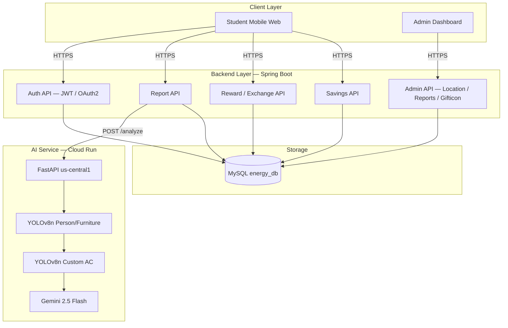
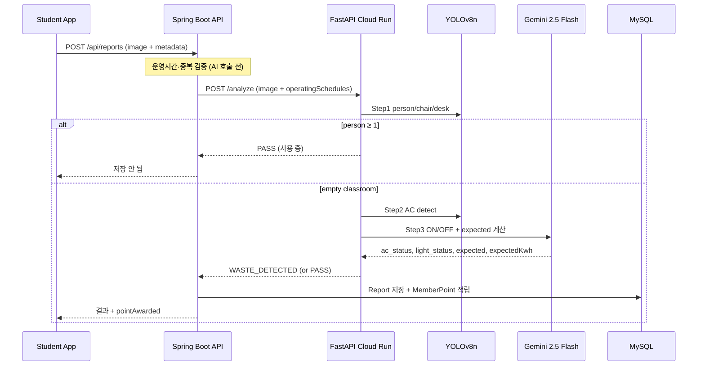
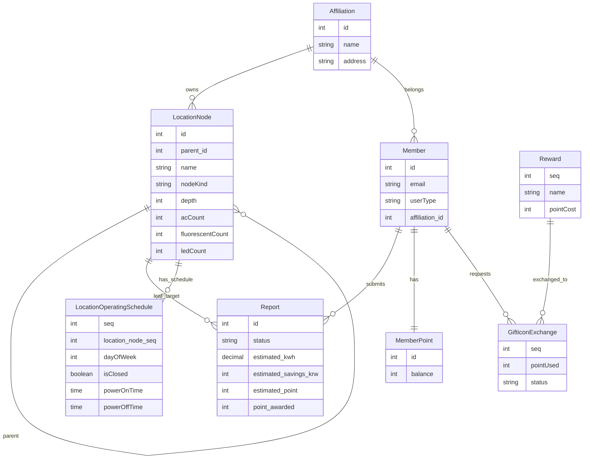
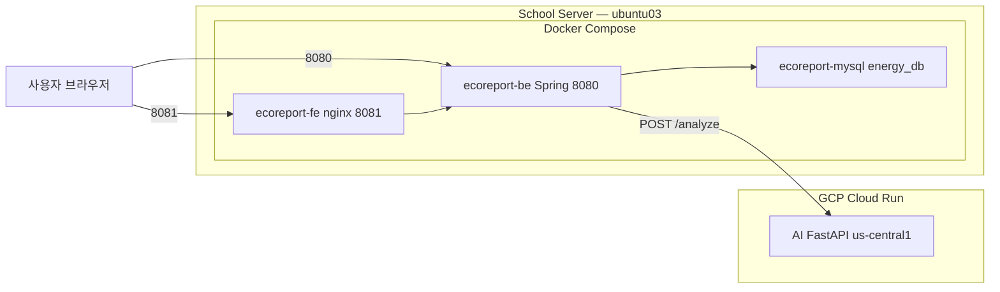

# 6. 시스템 구조

---

## 5.2.1. 전체 아키텍처



| 레이어 | 역할 |
|--------|------|
| **클라이언트** | 사용자(모바일웹) 및 관리자 대시보드 화면 제공 |
| **백엔드 API** | Spring Boot 기반 핵심 비즈니스 로직 및 REST API 처리 |
| **AI 분석 서버** | FastAPI 기반 이미지 분석 및 에너지 낭비 판별 (Cloud Run) |
| **데이터베이스** | 소속, 장소 계층, 제보 이력, 포인트 등 통합 데이터 관리 (MySQL) |

---

## 5.2.2. AI 판별 처리 흐름

사용자가 앱을 통해 제보 사진과 위치 전송 → 백엔드 수신 → AI 서버로 이미지 분석 요청 → 판별 결과(절약량, 낭비 여부)에 따라 백엔드에서 **포인트 즉시 적립** 및 데이터 저장.



---

## 5.2.3. AI 3단계 판별 로직

```
[클라이언트] 사진 업로드 + LocationNode LEAF 선택
    ▼
[Spring Boot] metadata: roomName, reportedAt, 자원 수량, operatingSchedules
    ▼
[1단계] YOLOv8n (conf=0.3, person/chair/desk)
    ├─ chair=0 AND desk=0 → ERROR (강의실 아님)
    ├─ person ≥ 1 → PASS (사용 중)
    └─ person = 0 ↓
[2단계] YOLOv8n Custom ac_best.pt (conf=0.4)
    ├─ 에어컨 미탐지 → [3단계 시나리오 B: 원본만]
    └─ 에어컨 탐지 → OpenCV 크롭 → [3단계 시나리오 A: 원본+크롭]
[3단계] Gemini 2.5 Flash
    ├─ operatingSchedules 참고 → 운영 외 시간대 판단
    ├─ ac_status=ON 또는 light_status=ON → WASTE_DETECTED
    │   └─ expected("N원"), expectedKwh("N kWh") 산출
    └─ 모두 OFF 또는 운영 중 → PASS
    ▼
[Spring Boot]
    ├─ WASTE_DETECTED → Report + estimated 필드 + MemberPoint 적립
    ├─ PASS / ERROR → 저장 안 함
    └─ AI 통신 실패 → INTERNAL_SERVER_ERROR (5003)
```

---

## 5.2.4. 데이터베이스 ERD



---

## 5.2.5. 배포 구성



---

## 5.2.6. 주요 API 엔드포인트

| Method | Endpoint | 설명 | 인증 |
|--------|----------|------|------|
| POST | `/login` | 이메일 로그인 (BCrypt + JWT) | 없음 |
| POST | `/register` | 회원가입 | 없음 |
| GET | `/api/affiliations` | 소속 목록 | 없음 |
| GET | `/api/buildings` | 장소 트리 (LEAF `reportable` 포함) | 없음 |
| GET | `/api/points/me` | 포인트 잔액 | JWT |
| POST | `/api/points/exchange` | 포인트 교환 | JWT |
| GET | `/api/rewards` | 리워드 목록 | 없음 |
| POST | `/api/reports` | 제보 생성 + AI + 포인트 적립 | JWT |
| GET | `/api/reports/me` | 내 제보 목록 | JWT |
| GET | `/api/savings/buildings/me` | 건물별 절약량 | JWT |
| GET/PATCH/POST/DELETE | `/api/admin/location-nodes/*` | 장소 CRUD | JWT · ADMIN |
| GET/PATCH | `/api/admin/reports` | 관리자 제보 목록·상태 변경 | JWT · ADMIN |
| GET | `/api/admin/dashboard` | 월간 절감 대시보드 | JWT · ADMIN |
| GET | `/api/admin/stats` | 통계 집계 | JWT · ADMIN |
| GET/PATCH | `/api/admin/gifticon-exchanges/*` | 기프티콘 교환 관리 | JWT · ADMIN |
| POST | `/analyze` | AI Service (Cloud Run) | — |

> 전체 명세: [API_명세서.md](../기획/캠퍼스_에너지_절약/04_기술_기획/API_명세서.md) · Swagger `/swagger-ui.html`

---

[← 기술 스택](./5_기술스택.md) · [목차](./README.md) · [다음: 구현 상세 →](./7_구현상세.md)
