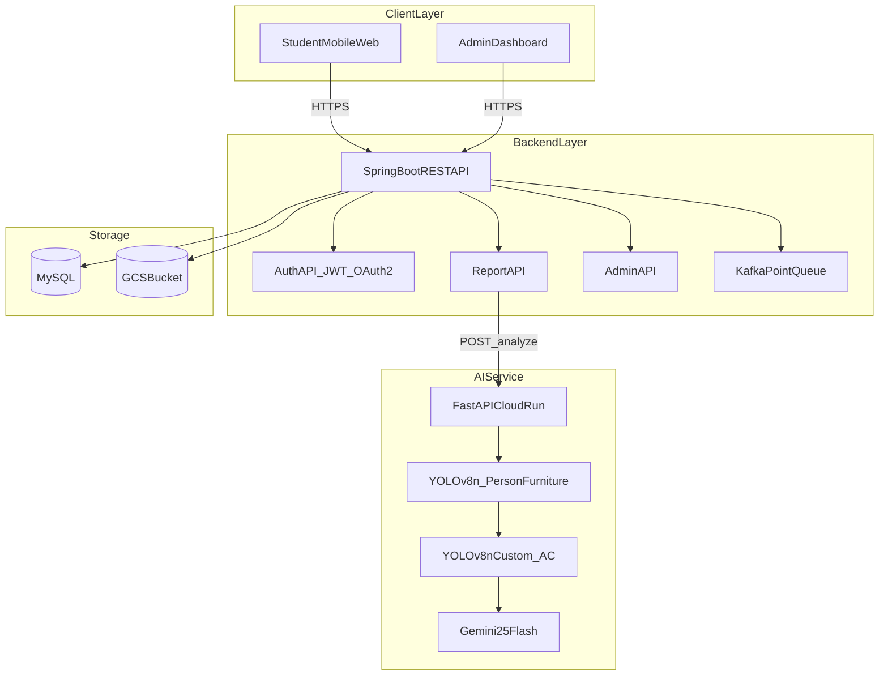
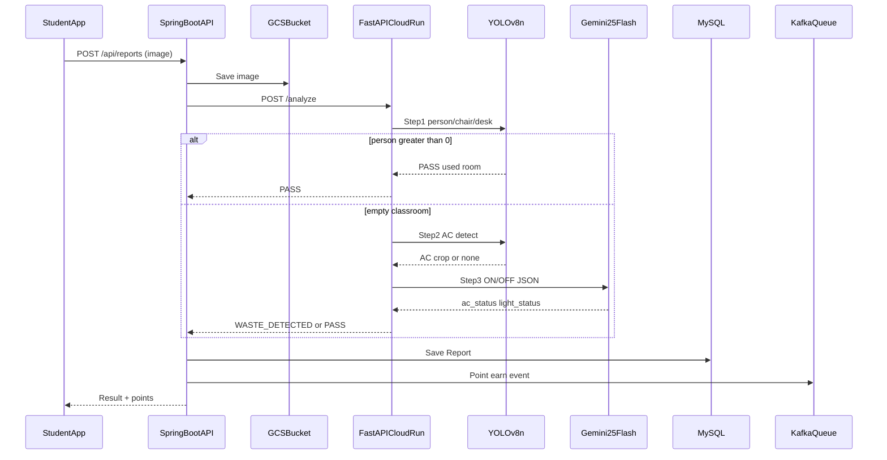
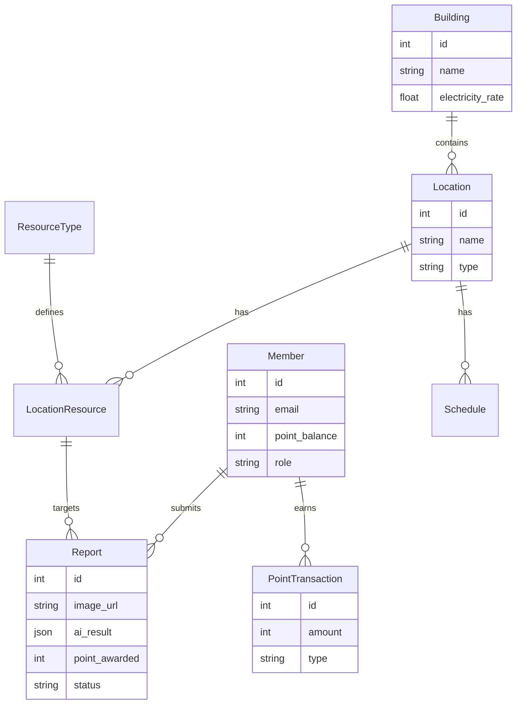
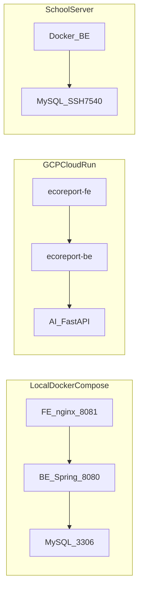

# 6. 시스템 구조

---

## 1. 전체 아키텍처



---

## 2. 레이어 구성 (텍스트)

```
┌─────────────────────────────────────────────────────────────────┐
│                          Client Layer                           │
│  [학생 모바일 웹앱 React]     [관리자 웹 대시보드 React]           │
└──────────────────┬──────────────────────┬───────────────────────┘
                   │ HTTPS                │ HTTPS
                   ▼                      ▼
┌─────────────────────────────────────────────────────────────────┐
│                       API Gateway / Backend                     │
│              [Spring Boot REST API]                             │
│         ┌───────────┬──────────────┬────────────┐              │
│         │ Auth API  │ Report API   │ Admin API  │              │
│         │ JWT/OAuth2│ 제보 CRUD    │ 대시보드   │              │
│         └───────────┴──────┬───────┴────────────┘              │
│                            │ HTTP (내부 호출)                   │
└────────────────────────────┼────────────────────────────────────┘
                             │
                             ▼
┌─────────────────────────────────────────────────────────────────┐
│              AI Service (FastAPI — Cloud Run)                   │
│  POST /analyze                                                  │
│  YOLOv8n → YOLOv8n Custom → Gemini 2.5 Flash                   │
└────────────────────────────┬────────────────────────────────────┘
                             │
           ┌─────────────────┼─────────────────┐
           ▼                 ▼                 ▼
  [Vertex AI Gemini]    [MySQL DB]        [GCS Bucket]
```

---

## 3. AI 판별 처리 흐름 (시퀀스)



---

## 4. AI 3단계 판별 로직

```
[클라이언트] 사진 업로드
    ▼
[Spring Boot] GCS 저장 → AI Service POST /analyze
    ▼
[1단계] YOLOv8n (conf=0.3, person/chair/desk)
    ├─ chair=0 AND desk=0 → ERROR (강의실 아님)
    ├─ person ≥ 1 → PASS (사용 중)
    └─ person = 0 ↓
[2단계] YOLOv8n Custom ac_best.pt (conf=0.4)
    ├─ 에어컨 미탐지 → [3단계 시나리오 B]
    └─ 에어컨 탐지 → 크롭 → [3단계 시나리오 A]
[3단계] Gemini 2.5 Flash
    ├─ 낭비 감지 → WASTE_DETECTED
    └─ 모두 꺼짐 → PASS
    ▼
[Spring Boot] Report 저장 → 어뷰징 필터 → 절약량 계산 → Kafka 포인트 적립
    ▼
[클라이언트] 결과 반환
```

---

## 5. 데이터베이스 ERD (요약)



---

## 6. 배포 구성



| 환경 | 명령 | 구성 |
|------|------|------|
| **로컬 통합** | `bash deploy.sh` | Docker Compose: MySQL + BE(8080) + FE(8081, nginx) |
| **BE 단독** | `be/deploy.sh` {build\|docker\|cloudrun} | Spring Boot multi-stage Dockerfile |
| **FE 단독** | `fe/deploy.sh` {build\|docker\|cloudrun} | Vite build → nginx, `VITE_API_HOST` bake-in |
| **GCP** | `bash deploy.sh cloudrun` | BE Cloud Run → FE Cloud Run (asia-northeast3) |
| **학교 서버** | Docker + Git clone | MySQL(SSH 7540), BE 8081 (외부 포트 개방 신청) |

---

## 7. 주요 API 엔드포인트

| Method | Endpoint | 설명 |
|--------|----------|------|
| POST | `/api/reports` | 제보 사진 업로드 + AI 판별 요청 |
| GET | `/api/reports/me` | 내 제보 이력 |
| GET | `/api/points/me` | 내 포인트 잔액 |
| POST | `/api/points/exchange` | 포인트 교환 신청 |
| POST | `/admin/buildings` | 건물 등록 (관리자) |
| GET | `/admin/reports` | 제보 목록 (관리자) |
| GET | `/admin/dashboard` | 월간 절약 현황 (관리자) |
| POST | `/analyze` | AI Service — 이미지 분석 (FastAPI) |

---

[← 기술 스택](./5_기술스택.md) · [목차](./README.md) · [다음: 구현 상세 →](./7_구현상세.md)
