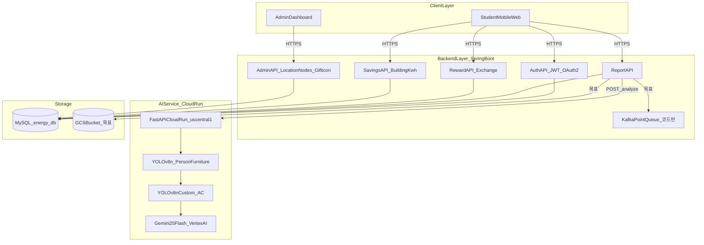
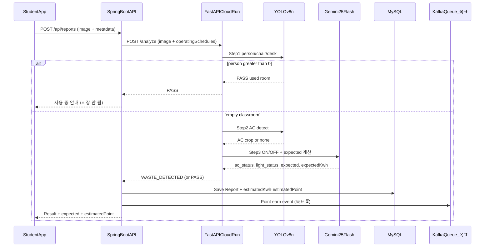
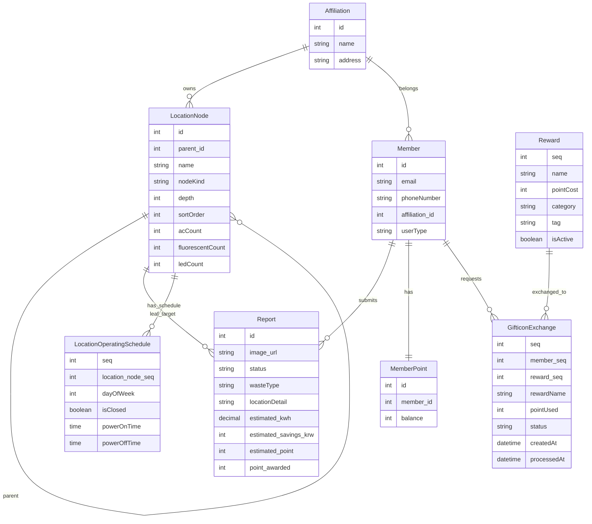
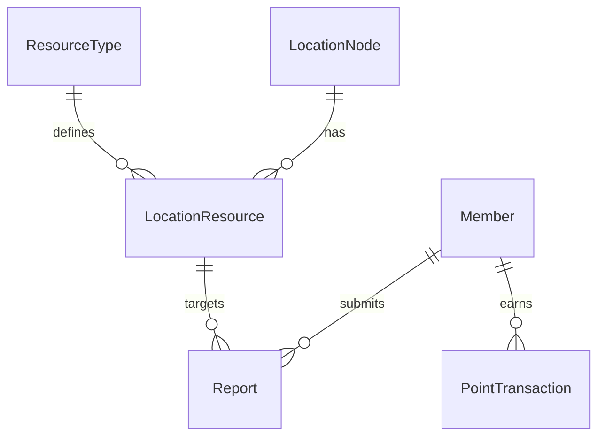
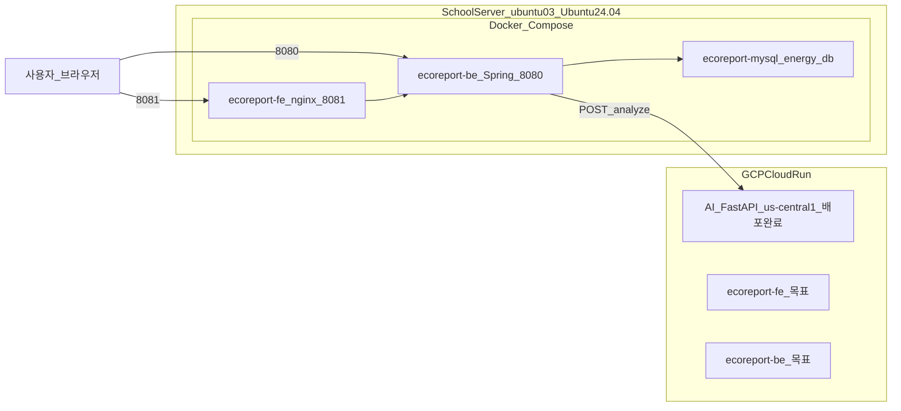

# 6. 시스템 구조

---

## 1. 전체 아키텍처



---

## 2. 레이어 구성 (텍스트)

```
┌─────────────────────────────────────────────────────────────────┐
│                          Client Layer                           │
│  [학생 모바일 웹앱 React]        [관리자 웹 대시보드 React]         │
│  홈·제보·이력·포인트샵·마이페이지   장소관리·기프티콘·제보·통계·사용자  │
└──────────────────┬──────────────────────┬───────────────────────┘
                   │ HTTPS                │ HTTPS
                   ▼                      ▼
┌─────────────────────────────────────────────────────────────────┐
│                       Spring Boot REST API                      │
│  ┌──────────┬──────────┬──────────┬──────────┬───────────┐     │
│  │Auth API  │Report API│Reward API│Savings   │Admin API  │     │
│  │JWT/OAuth2│제보 CRUD │교환·리워드│건물절약량 │장소·기프티콘│    │
│  └──────────┴────┬─────┴──────────┴──────────┴───────────┘     │
│                  │ HTTP (Cloud Run 호출)                        │
└──────────────────┼────────────────────────────────────────────-─┘
                   │
                   ▼
┌─────────────────────────────────────────────────────────────────┐
│              AI Service (FastAPI — GCP Cloud Run us-central1)   │
│  POST /analyze                                                  │
│  YOLOv8n → YOLOv8n Custom (ac_best.pt, mAP 0.990)              │
│    → Gemini 2.5 Flash (ON/OFF 판별 + expected 절약금액 계산)       │
└────────────────────────────┬────────────────────────────────────┘
                             │
           ┌─────────────────┼─────────────────┐
           ▼                 ▼                 ▼
  [Vertex AI Gemini]    [MySQL DB]        [GCS Bucket ⏳]
```

---

## 3. AI 판별 처리 흐름 (시퀀스)



---

## 4. AI 3단계 판별 로직

```
[클라이언트] 사진 업로드 + 위치(LocationNode LEAF) 선택
    ▼
[Spring Boot] BE → AI Service POST /analyze
             (image + operatingSchedules metadata)
    ▼
[1단계] YOLOv8n (conf=0.3, person/chair/desk)
    ├─ chair=0 AND desk=0 → ERROR (강의실 아님)
    ├─ person ≥ 1 → PASS (사용 중)
    └─ person = 0 ↓
[2단계] YOLOv8n Custom ac_best.pt (conf=0.4)
    ├─ 에어컨 미탐지 → [3단계 시나리오 B: 원본만 전달]
    └─ 에어컨 탐지 → OpenCV 크롭 → [3단계 시나리오 A: 원본 + 크롭 전달]
[3단계] Gemini 2.5 Flash
    ├─ operatingSchedules 참고 → 운영 외 시간대 판단
    ├─ ac_status=ON 또는 light_status=ON → WASTE_DETECTED
    │   └─ 에너지 상수(형광등 32W, LED 15W, AC 1,500W, 120원/kWh) 적용
    │       → expected("N원"), expectedKwh("N kWh") 산출
    └─ 모두 꺼짐 또는 운영 중 → PASS
    ▼
[Spring Boot]
    ├─ WASTE_DETECTED → Report 저장 + estimated 필드 저장 (Kafka·잔액 적립 ⏳)
    ├─ PASS / ERROR → 저장 안 함 (BusinessLogicException 반환)
    └─ AI 통신 실패 → INTERNAL_SERVER_ERROR (5003)
    ▼
[클라이언트] 결과 + 절약 금액·전기량 표시
```

---

## 5. 데이터베이스 ERD

> **현재 MVP**: `Affiliation`, `LocationNode`(GROUP/LEAF 트리), `LocationOperatingSchedule`(요일별 on/off), `Member`(phoneNumber 포함), `Report`, `MemberPoint`, `Reward`, `GifticonExchange`.  
> **목표 확장**: ResourceType, LocationResource — [자원_관리_설계.md](../기획/캠퍼스_에너지_절약/04_기술_기획/자원_관리_설계.md)



**목표 ERD** (ResourceType 등 미구현):



---

## 6. 배포 구성



| 환경 | 명령 | 구성 | MVP |
|------|------|------|-----|
| **학교 서버 통합** | `bash deploy.sh` | Docker Compose: MySQL + BE(8080) + FE(8081, nginx) | ✅ |
| **BE 단독** | `bash be/deploy.sh` | MySQL(필요 시) + BE Compose 기동 | ✅ |
| **FE 단독** | `bash fe/deploy.sh` | FE Compose 기동 | ✅ |
| **AI FastAPI** | GCP Cloud Run | `us-central1`, BE `/analyze` 연동 | ✅ |
| **GCP Cloud Run BE·FE** | *(미구현)* | asia-northeast3 목표 | ⏳ |

---

## 7. API 엔드포인트

### 7.1 현재 구현 (MVP)

| Method | Endpoint | 설명 | 인증 |
|--------|----------|------|------|
| GET | `/ping` | 헬스 확인 | 없음 |
| POST | `/login` | 이메일 로그인 (BCrypt 검증 + JWT 발급) | 없음 |
| POST | `/register` | 회원가입 (affiliation·phoneNumber 포함) | 없음 |
| GET | `/register/check-email` | 이메일 중복 확인 | 없음 |
| GET | `/register/check-username` | 사용자명 중복 확인 | 없음 |
| GET | `/register/check-phone` | 전화번호 중복 확인 | 없음 |
| GET | `/api/affiliations` | 소속 목록 | 없음 |
| GET | `/api/buildings` | 장소 트리 (nested) | 없음 |
| PATCH | `/api/me/affiliation` | 소속·담당 구역 변경 (OAuth 가입 후 등) | JWT |
| PATCH | `/api/me/building` | 담당 GROUP 노드 변경 (관리자) | JWT |
| GET | `/api/points/me` | 포인트 잔액 조회 | JWT |
| POST | `/api/points/exchange` | 포인트 교환 신청 (기프티콘) | JWT |
| GET | `/api/points/exchanges/me` | 내 기프티콘 교환 이력 | JWT |
| GET | `/api/rewards` | 리워드 상품 목록 | 없음 |
| POST | `/api/reports` | 제보 생성 (FastAPI `/analyze` 연동) | JWT |
| GET | `/api/reports/me` | 내 제보 목록 (page, size, status) | JWT |
| GET | `/api/reports/{reportId}` | 제보 상세 (본인만) | JWT |
| GET | `/api/savings/buildings/me` | 내 건물 절약량 (kWh·금액·건수) | JWT |
| GET | `/api/admin/location-nodes/tree` | 관리자 장소 트리 | JWT(ADMIN) |
| POST | `/api/admin/location-nodes` | 장소 생성 | JWT(ADMIN) |
| PATCH | `/api/admin/location-nodes/{id}` | 장소 수정 | JWT(ADMIN) |
| DELETE | `/api/admin/location-nodes/{id}` | 장소 삭제 | JWT(ADMIN) |
| GET | `/api/admin/gifticon-exchanges` | 전체 교환 목록 (status 필터) | JWT(ADMIN) |
| GET | `/api/admin/gifticon-exchanges/stats` | 교환 통계 | JWT(ADMIN) |
| PATCH | `/api/admin/gifticon-exchanges/{exchangeId}` | 교환 상태 변경 | JWT(ADMIN) |
| POST | `/analyze` | AI Service (FastAPI Cloud Run, 별도 서비스) | — |

### 7.2 목표 API (P0/P1)

| Method | Endpoint | 설명 |
|--------|----------|------|
| GET | `/api/admin/reports` | 제보 목록 (관리자) — FE mock ⏳ |
| GET | `/api/admin/dashboard` | 월간 절약 현황 (관리자) — FE mock ⏳ |
| POST | `/api/admin/.../resources` | 장소-자원 매핑 (ResourceType) ⏳ |

> 해커톤 데모: **관리자 제보·대시보드**는 FE mock. **장소 CRUD·기프티콘 관리·절약량·리워드·포인트 교환**은 BE 실연동. 제보 AI는 BE → Cloud Run FastAPI ✅ — `expected` 파싱 후 estimated 필드 저장, **잔액 자동 적립은 ⏳**. AI URL은 BE `ReportService`에 하드코딩(`.env` `CAMPUS_AI_API_URL` 분리 목표).

---

[← 기술 스택](./5_기술스택.md) · [목차](./README.md) · [다음: 구현 상세 →](./7_구현상세.md)
