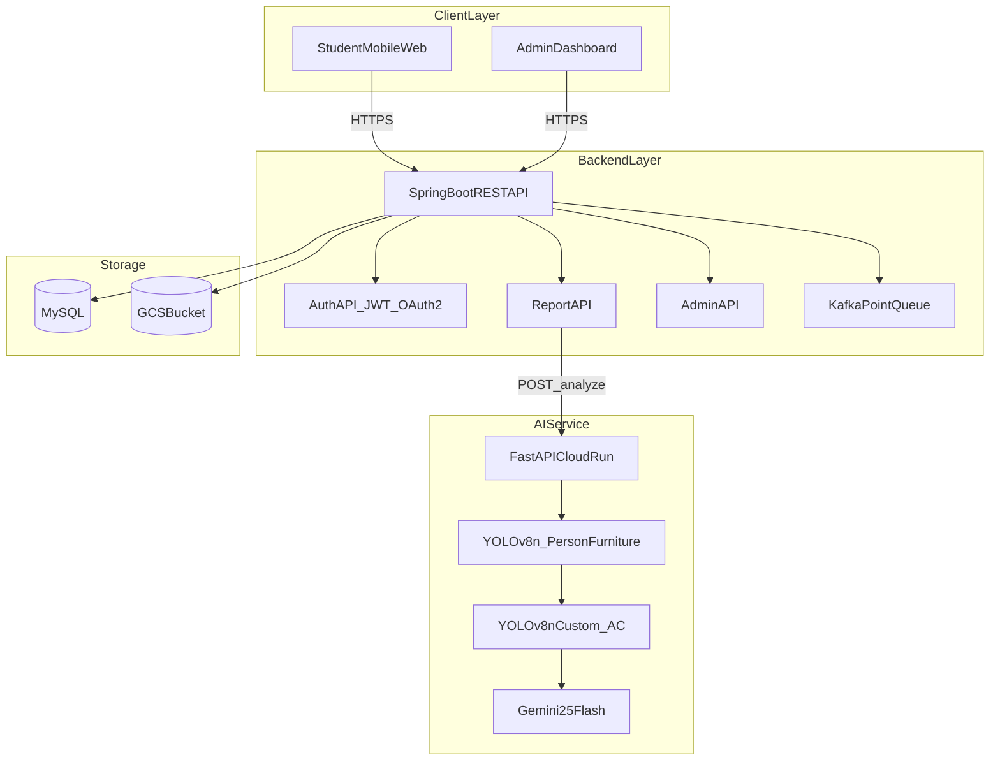
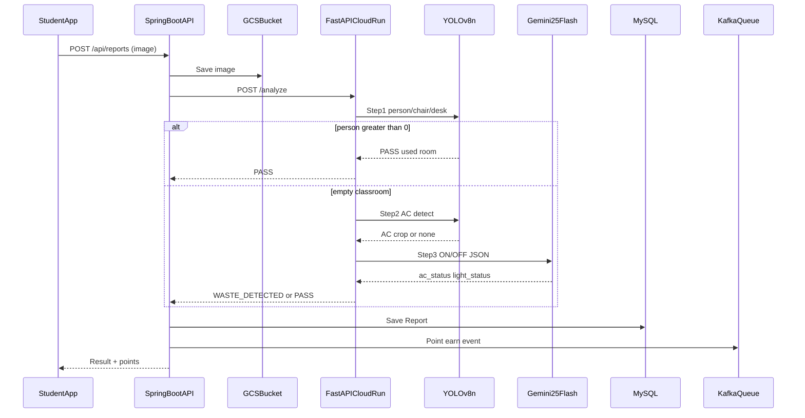
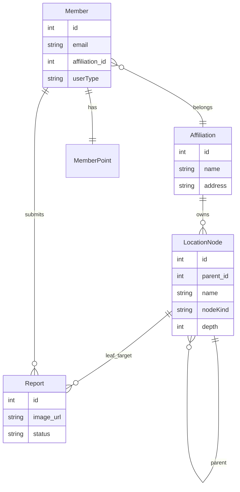
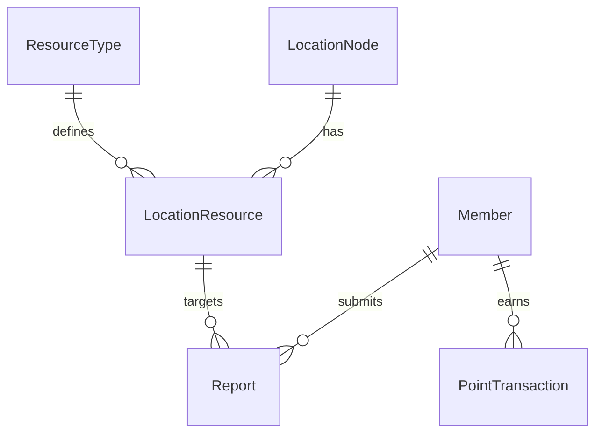
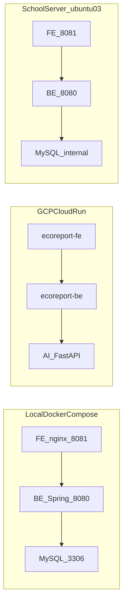

# 6. 시스템 구조

---

## 1. 전체 아키텍처



---

## 2. 레이어 구성 (텍스트)

```
┌─────────────────────────────────────────────────────────────────┐
│                          Client Layer                           │
│  [학생 모바일 웹앱 React]     [관리자 웹 대시보드 React]           │
└──────────────────┬──────────────────────┬───────────────────────┘
                   │ HTTPS                │ HTTPS
                   ▼                      ▼
┌─────────────────────────────────────────────────────────────────┐
│                       API Gateway / Backend                     │
│              [Spring Boot REST API]                             │
│         ┌───────────┬──────────────┬────────────┐              │
│         │ Auth API  │ Report API   │ Admin API  │              │
│         │ JWT/OAuth2│ 제보 CRUD    │ 대시보드   │              │
│         └───────────┴──────┬───────┴────────────┘              │
│                            │ HTTP (내부 호출)                   │
└────────────────────────────┼────────────────────────────────────┘
                             │
                             ▼
┌─────────────────────────────────────────────────────────────────┐
│              AI Service (FastAPI — Cloud Run)                   │
│  POST /analyze                                                  │
│  YOLOv8n → YOLOv8n Custom → Gemini 2.5 Flash                   │
└────────────────────────────┬────────────────────────────────────┘
                             │
           ┌─────────────────┼─────────────────┐
           ▼                 ▼                 ▼
  [Vertex AI Gemini]    [MySQL DB]        [GCS Bucket]
```

---

## 3. AI 판별 처리 흐름 (시퀀스)



---

## 4. AI 3단계 판별 로직

```
[클라이언트] 사진 업로드
    ▼
[Spring Boot] GCS 저장 → AI Service POST /analyze
    ▼
[1단계] YOLOv8n (conf=0.3, person/chair/desk)
    ├─ chair=0 AND desk=0 → ERROR (강의실 아님)
    ├─ person ≥ 1 → PASS (사용 중)
    └─ person = 0 ↓
[2단계] YOLOv8n Custom ac_best.pt (conf=0.4)
    ├─ 에어컨 미탐지 → [3단계 시나리오 B]
    └─ 에어컨 탐지 → 크롭 → [3단계 시나리오 A]
[3단계] Gemini 2.5 Flash
    ├─ 낭비 감지 → WASTE_DETECTED
    └─ 모두 꺼짐 → PASS
    ▼
[Spring Boot] Report 저장 → 어뷰징 필터 → 절약량 계산 → Kafka 포인트 적립
    ▼
[클라이언트] 결과 반환
```

---

## 5. 데이터베이스 ERD

> **현재 MVP**: `Affiliation`, `LocationNode`(GROUP/LEAF 트리), `Member`, `Report`, `MemberPoint`.  
> **목표 확장**: ResourceType, LocationResource — [자원_관리_설계.md](../기획/캠퍼스_에너지_절약/04_기술_기획/자원_관리_설계.md) · [장소_관리_모델.md](../기획/캠퍼스_에너지_절약/04_기술_기획/장소_관리_모델.md)



**목표 ERD** (ResourceType 등 미구현):



---

## 6. 배포 구성



| 환경 | 명령 | 구성 | MVP |
|------|------|------|-----|
| **로컬·학교 서버** | `bash deploy.sh` | Docker Compose: MySQL + BE(8080) + FE(8081, nginx) | ✅ |
| **BE 단독** | `bash be/deploy.sh` | MySQL(필요 시) + BE Compose 기동 | ✅ |
| **FE 단독** | `bash fe/deploy.sh` | FE Compose 기동 | ✅ |
| **GCP Cloud Run** | *(미구현)* | BE → FE (asia-northeast3) | ⏳ 목표 |
| **학교 서버** | Docker + Git clone | `ubuntu03`: FE 8081, BE 8080, MySQL 내부 | ✅ |

---

## 7. API 엔드포인트

### 7.1 현재 구현 (MVP)

| Method | Endpoint | 설명 |
|--------|----------|------|
| GET | `/ping` | 헬스 확인 |
| POST | `/login` | 이메일 로그인 (BCrypt 검증) |
| POST | `/register` | 회원가입 — body에 `affiliation`(선택) 지원 |
| GET | `/register/check-email`, `/register/check-username` | 중복 확인 |
| GET | `/api/affiliations` | 소속 목록 ✅ |
| GET | `/api/buildings` | 장소 트리 (nested) ✅ |
| GET/POST/PATCH/DELETE | `/api/admin/location-nodes` | 장소 CRUD (ADMIN) ✅ |
| GET | `/api/points/me` | 포인트 잔액 (JWT) |
| POST | `/api/reports` | 제보 생성 — FastAPI `/analyze` 연동 (JWT) |
| GET | `/api/reports/me`, `/api/reports/{id}` | 내 제보 목록·상세 (JWT) |

### 7.2 목표 API (P0/P1)

| Method | Endpoint | 설명 |
|--------|----------|------|
| POST | `/api/points/exchange` | 포인트 교환 신청 |
| GET | `/api/admin/reports` | 제보 목록 (관리자) — FE mock ⏳ |
| GET | `/api/admin/dashboard` | 월간 절약 현황 (관리자) — FE mock ⏳ |
| POST | `/api/admin/.../resources` | 장소-자원 매핑 (ResourceType) ⏳ |
| POST | `/analyze` | AI Service — 이미지 분석 (FastAPI, 별도 서비스) ✅ |

> 해커톤 데모: **관리자 제보·대시보드**는 FE mock. **장소 CRUD**는 BE 실연동. 제보 AI는 BE → Cloud Run FastAPI ✅.

---

[← 기술 스택](./5_기술스택.md) · [목차](./README.md) · [다음: 구현 상세 →](./7_구현상세.md)
