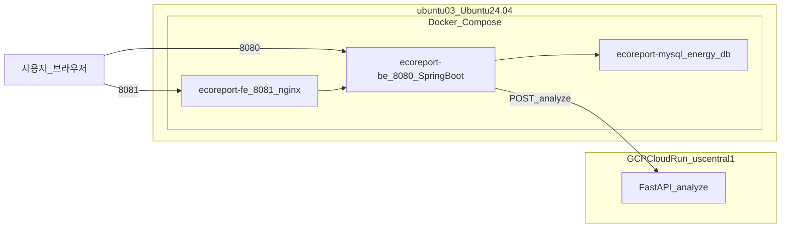

# 8. 개발 환경 및 운영 서버

---

## 1. 개발 IDE (교차 검증)

동일 코드베이스를 여러 에디터·IDE에서 열어 빌드·실행·리팩터링 결과를 비교함으로써 환경 종속 이슈를 조기에 발견했습니다.

| 도구 | 용도 |
|------|------|
| **Antigravity** | AI 기반 개발 보조, 코드 생성·리뷰 |
| **Cursor** | AI 페어 프로그래밍, 에이전트 기반 코드 수정 |
| **VS Code** | 범용 경량 에디터 |
| **IntelliJ IDEA** | Spring Boot 백엔드 개발·디버깅 |
| **WebStorm** | React/TypeScript 프론트엔드 개발·디버깅 |

---

## 2. AI 코딩 도구

| 도구 / 모델 | 주요 활용 |
|-------------|----------|
| **Composer 2.5** (Cursor) | 멀티파일 편집, 기능 단위 구현, 리팩터링 |
| **Claude** | 아키텍처 설계 검토, 로직 설명·코드 리뷰, 문서 작성 |
| **Gemini CLI** | 터미널 기반 빠른 질의, 스크립트·설정 파일 작성 |
| **GPT** | 대안 구현 제안, API 명세·에러 메시지 정리 |

**워크플로우**

```
기능 기획 → Composer/Claude로 초안 구현
         → Gemini CLI/GPT로 대안·엣지 케이스 검토
         → IntelliJ/WebStorm/VS Code에서 빌드·실행 검증
         → Cursor Agent로 수정·통합
```

---

## 3. 디자인 도구 및 코드 전환

| 도구 | 역할 |
|------|------|
| **Stitch** (Google) | 화면 와이어프레임·UI 시안 생성 |
| **VinSign** | 시각 디자인·브랜딩 요소 보완 |
| **Google AI Studio** | Stitch/VinSign 시안 → React + Tailwind 코드 변환 |

```
Stitch / VinSign (시안)
        ↓
Google AI Studio (코드 생성)
        ↓
fe/src/ (React 19 + TailwindCSS v4 + shadcn/ui)
        ↓
디자인_가이드.md 토큰 적용 (Volt Yellow #FFC107, Eco Green #4CAF50)
```

---

## 4. 운영 서버 사양

| 항목 | 값 |
|------|-----|
| **호스트명** | `ubuntu03` |
| **OS** | Ubuntu 24.04.3 LTS |
| **커널** | Linux 6.8.0-106-generic |
| **아키텍처** | x86-64 |
| **하드웨어** | Gigabyte Z270X-Ultra Gaming |

### CPU

| 항목 | 사양 |
|------|------|
| **프로세서** | Intel Core i7-7700 @ 3.60GHz |
| **코어 / 스레드** | 4코어 / 8스레드 |
| **최대 클럭** | 4.2 GHz |

### 메모리 / 스토리지

| 항목 | 값 |
|------|-----|
| **RAM** | 31 GiB (가용 ~28 GiB) |
| **Swap** | 8.0 GiB |
| **NVMe** | 232.9 GB / LVM 226 GB (`/`, 사용률 10%) |

---

## 5. Docker 컨테이너 (운영 중)

| 컨테이너명 | 이미지 | 포트 | 역할 |
|------------|--------|------|------|
| `ecoreport-fe` | `duyuthon-fe` | `0.0.0.0:8081 → 80` | 프론트엔드 (nginx) |
| `ecoreport-be` | `duyuthon-be` | `0.0.0.0:8080 → 8080` | 백엔드 (Spring Boot) |
| `ecoreport-mysql` | `mysql:8.4` | `3306` (내부) | MySQL `energy_db` |

### DB 구성

| 항목 | 값 |
|------|-----|
| DB 이름 | `energy_db` |
| 마이그레이션 | Flyway (`V1~V6` + `R__seed_dev.sql`) |
| BE 연결 | `jdbc:mysql://mysql:3306/energy_db` |
| DDL 전략 | `ddl-auto: validate` |
| 데이터 영속 | Docker volume `mysql_data` |

**현재 테이블**: `member_db`, `affiliation_db`, `location_node_db`, `location_operating_schedule_db`, `report_db`, `member_point_db`, `reward_db`, `gifticon_exchange_db`

### AI FastAPI (GCP Cloud Run)

| 항목 | 값 |
|------|-----|
| 서비스명 | Cloud Run (`us-central1`) |
| 엔드포인트 | `POST /analyze` |
| 모델 파일 | `models/ac_best.pt` |
| 연동 | BE `ReportService.callAiApi()` — 제보 생성 시 자동 호출 |

---

## 6. 접속 URL

| 서비스 | URL |
|--------|-----|
| 프론트엔드 | `http://<DEPLOY_PUBLIC_HOST>:8081` |
| 백엔드 API | `http://<DEPLOY_PUBLIC_HOST>:8080` |
| Swagger UI | `http://<DEPLOY_PUBLIC_HOST>:8080/swagger-ui.html` |
| 헬스 체크 | `http://<DEPLOY_PUBLIC_HOST>:8080/actuator/health` |

---

## 7. 환경 변수 (`.env`)

프로젝트 루트 `.env` 단일 파일로 관리 (`cp .env.example .env`).

| 변수 | 용도 |
|------|------|
| `MYSQL_DATABASE`, `MYSQL_USER`, `MYSQL_PASSWORD` | Docker MySQL 설정 |
| `SPRING_DATASOURCE_URL/USERNAME/PASSWORD` | BE DB 연결 |
| `JWT_SECRET` | JWT HS256 서명 키 |
| `GOOGLE_CLIENT_ID/SECRET` | Google OAuth2 |
| `CAMPUS_AI_API_URL` | Cloud Run `/analyze` 엔드포인트 |
| `VITE_API_HOST` | FE API baseURL (빌드 타임 주입) |
| `DEPLOY_PUBLIC_HOST` | 학교 서버 공개 IP |

---

## 8. 배포 구성도



---

[← 구현 상세](./7_구현상세.md) · [목차](./README.md)
