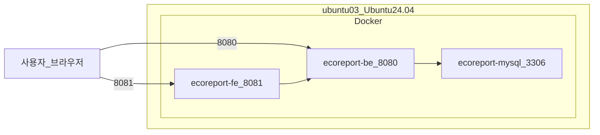

# 8. 개발 환경 및 운영 서버

> 에코리포트 개발에 사용한 IDE·AI·디자인 도구와 실제 운영 중인 서버 사양

---

## 1. 개발 IDE (교차 검증)

본 프로젝트는 단일 IDE에 의존하지 않고, 여러 개발 환경을 **번갈아 가며 교차 검증**하는 방식으로 진행했다.  
동일 코드베이스를 서로 다른 에디터·IDE에서 열어 빌드·실행·리팩터링 결과를 비교함으로써 환경 종속 이슈와 숨은 오류를 조기에 발견했다.

| 도구 | 용도 |
|------|------|
| **Antigravity** | AI 기반 개발 보조, 코드 생성·리뷰 |
| **Cursor** | AI 페어 프로그래밍, 에이전트 기반 코드 수정 |
| **VS Code** | 범용 경량 에디터, 확장 플러그인 활용 |
| **IntelliJ IDEA** | Spring Boot 백엔드 개발·디버깅 |
| **WebStorm** | React/TypeScript 프론트엔드 개발·디버깅 |

**교차 검증 방식**

- FE: WebStorm / VS Code / Cursor에서 빌드·린트·실행 결과 비교
- BE: IntelliJ / VS Code / Cursor에서 Gradle 빌드·부트 실행·API 테스트 비교
- AI 도구(Antigravity, Cursor)로 생성된 코드는 반드시 다른 IDE에서 한 번 더 열어 컴파일·실행 확인

---

## 2. AI 코딩 도구

코드 작성·리팩터링·디버깅·문서화 과정에서 아래 AI 모델·도구를 **상황에 맞게 병행** 사용했다.

| 도구 / 모델 | 주요 활용 |
|-------------|----------|
| **Composer 2.5** (Cursor) | 멀티파일 편집, 기능 단위 구현, 리팩터링 |
| **Claude** | 아키텍처 설계 검토, 복잡한 로직 설명·코드 리뷰 |
| **Gemini CLI** | 터미널 기반 빠른 질의, 스크립트·설정 파일 작성 |
| **Gemini** (웹/API) | AI 모델 연동 설계, 프롬프트 초안, 문서 작성 |
| **GPT** | 대안 구현 제안, API 명세·에러 메시지 정리 |

**워크플로우 요약**

```
기능 기획 → Composer/Claude로 초안 구현
         → Gemini CLI/GPT로 대안·엣지 케이스 검토
         → IntelliJ/WebStorm/VS Code에서 빌드·실행 검증
         → Cursor Agent로 수정·통합
```

---

## 3. 디자인 도구 및 코드 전환

UI/UX 시안은 AI 디자인 도구로 먼저 제작한 뒤, **Google AI Studio**를 통해 React/Tailwind 코드로 변환하여 프로젝트에 반영했다.

| 도구 | 역할 |
|------|------|
| **Stitch** (Google) | 화면 와이어프레임·UI 시안 생성, 프롬프트 기반 디자인 |
| **VinSign** | 시각 디자인·브랜딩 요소 보완 |
| **Google AI Studio** | Stitch/VinSign 시안 → React + Tailwind 코드 변환 |

**디자인 → 코드 파이프라인**

```
Stitch / VinSign (시안·프롬프트)
        ↓
Google AI Studio (코드 생성)
        ↓
fe/src/ (React 19 + TailwindCSS v4 + shadcn/ui로 통합)
        ↓
디자인_가이드.md 토큰(Volt Yellow, Eco Green) 적용
```

관련 문서: [디자인 가이드](../디자인/디자인_가이드.md), [Stitch 프롬프트](../디자인/stitch_프롬프트.md)

---

## 4. 운영 서버 개요

| 항목 | 값 |
|------|-----|
| **호스트명** | `ubuntu03` |
| **OS** | Ubuntu 24.04.3 LTS (noble) |
| **커널** | Linux 6.8.0-106-generic |
| **아키텍처** | x86-64 |
| **하드웨어** | Gigabyte Z270X-Ultra Gaming |
| **접속 IP** | `YOUR_DEPLOY_HOST` (배포 스크립트 출력 기준) |

---

## 5. 서버 하드웨어 사양

### CPU

| 항목 | 사양 |
|------|------|
| **프로세서** | Intel Core i7-7700 @ 3.60GHz |
| **코어 / 스레드** | 4코어 / 8스레드 |
| **최대 클럭** | 4.2 GHz |
| **가상화** | VT-x 지원 |

### 메모리

| 항목 | 용량 |
|------|------|
| **RAM** | 31 GiB (사용 ~2.4 GiB, 가용 ~28 GiB) |
| **Swap** | 8.0 GiB |

### 스토리지

| 장치 | 용량 | 마운트 | 사용률 |
|------|------|--------|--------|
| **NVMe** (`nvme0n1`) | 232.9 GB | — | — |
| └ LVM (`ubuntu--vg-ubuntu--lv`) | 226 GB | `/` | 10% (21 GB 사용) |
| └ `/boot` | 2 GB | `/boot` | 11% |
| └ `/boot/efi` | 1.1 GB | `/boot/efi` | 1% |

---

## 6. Docker 컨테이너 (운영 중)

서버에서 `docker ps` 기준 **2026-05-21** 현재 아래 3개 컨테이너가 24시간 이상 가동 중이다.

| 컨테이너명 | 이미지 | 포트 매핑 | 역할 |
|------------|--------|-----------|------|
| `ecoreport-fe` | `duyuthon-fe` | `0.0.0.0:8081 → 80` | 프론트엔드 (nginx) |
| `ecoreport-be` | `duyuthon-be` | `0.0.0.0:8080 → 8080` | 백엔드 (Spring Boot) |
| `ecoreport-mysql` | `mysql:8.4` | `3306` (내부) | MySQL 데이터베이스 (healthy) |

### 접속 URL (원격 서버)

| 서비스 | URL |
|--------|-----|
| 프론트엔드 | http://YOUR_DEPLOY_HOST:8081 |
| 백엔드 API | http://YOUR_DEPLOY_HOST:8080 |
| Swagger UI | http://YOUR_DEPLOY_HOST:8080/swagger-ui.html |
| 헬스 체크 | http://YOUR_DEPLOY_HOST:8080/actuator/health |

> **운영 범위**: FE·BE·MySQL 3컨테이너만 가동. Kafka·Cloud Run·AI FastAPI는 이 서버에 배포되지 않았으며, 데모는 FE mock AI(`VITE_USE_MOCK`)로 동작한다.

> MySQL은 Docker 내부 네트워크(`3306`)로만 노출되며, 외부 직접 접속은 SSH 터널링(포트 7540)을 사용한다.  
> 상세 배포 절차: [배포 가이드](../기획/캠퍼스_에너지_절약/04_기술_기획/배포_가이드.md)

---

## 7. 배포 구성도 (운영 서버)



---

## 8. 원본 서버 점검 로그 (참고)

<details>
<summary>hostnamectl / lscpu / free / df / docker ps 출력</summary>

```
Static hostname: ubuntu03
Operating System: Ubuntu 24.04.3 LTS
Kernel: Linux 6.8.0-106-generic
Architecture: x86-64
Hardware: Gigabyte Z270X-Ultra Gaming

CPU: Intel(R) Core(TM) i7-7700 CPU @ 3.60GHz
     4 cores / 8 threads, max 4.2 GHz

Mem:  31Gi total, 2.4Gi used, 28Gi available
Swap: 8.0Gi total, 0B used

Disk: /dev/mapper/ubuntu--vg-ubuntu--lv  226G  21G used  196G avail  10%  /

CONTAINER ID   IMAGE         PORTS                              NAMES
bdce99c7cefa   duyuthon-fe   0.0.0.0:8081->80/tcp               ecoreport-fe
89721159fc33   duyuthon-be   0.0.0.0:8080->8080/tcp             ecoreport-be
439927171dd5   mysql:8.4     3306/tcp (healthy)                 ecoreport-mysql
```

</details>

---

[← 구현 상세](./7_구현상세.md) · [목차](./README.md)
